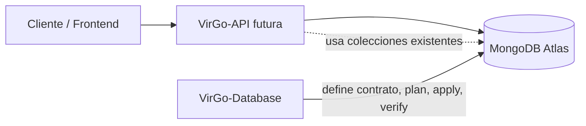
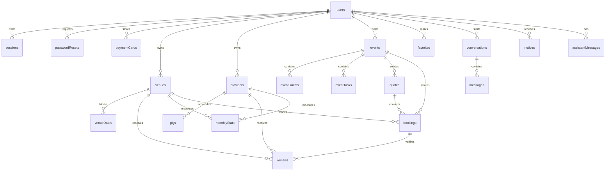

# VirGo API Handoff

**Documento de transferencia técnica para la futura `VirGo-API`**

| Dato | Valor |
| --- | --- |
| Proyecto de datos | `VirGo-Database` |
| Base de datos de desarrollo | `virgo_dev` |
| Base de datos de producción prevista | `virgo` |
| Estado de datos en desarrollo | 22 colecciones, 38 índices secundarios, 4 TTL, 0 documentos de negocio |
| Estado de la API | No existe implementación de `VirGo-API` |
| Fecha del documento | 2026-11-09 |
| Audiencia | Desarrollador o equipo responsable de diseñar e implementar el backend |

> **Advertencia:** este documento no declara endpoints existentes. Todos los contratos REST de la sección 9 son **propuestas de diseño**. La única fuente de verdad de campos, validadores e índices es `VirGo-Database/src/catalog`; `VirGo-API/db/schema` se genera desde ese catálogo.

## Cómo leer este documento

Cada afirmación relevante se clasifica con una de estas etiquetas:

| Etiqueta | Significado |
| --- | --- |
| **IMPLEMENTADO** | Existe en validadores, índices, scripts, pruebas o configuración de `VirGo-Database`. |
| **APROBADO** | Está documentado como decisión en `docs/DECISIONS.md` o en la documentación operativa, aunque no necesariamente ejecutado por este repositorio. |
| **PROPUESTO** | Es una recomendación de diseño para la futura API. No existe todavía. |
| **PENDIENTE** | Requiere una decisión de producto, seguridad o arquitectura antes de implementarse. |
| **NO VERIFICABLE** | No puede confirmarse con los archivos fuente disponibles. |

## Tabla de contenido

1. [Introducción al proyecto](#1-introducción-al-proyecto)
2. [Arquitectura actual](#2-arquitectura-actual)
3. [Tecnologías y configuración](#3-tecnologías-y-configuración)
4. [Modelo de datos completo](#4-modelo-de-datos-completo)
5. [Reglas de negocio](#5-reglas-de-negocio)
6. [Operaciones transaccionales](#6-operaciones-transaccionales)
7. [Seguridad](#7-seguridad)
8. [Índices y rendimiento](#8-índices-y-rendimiento)
9. [Contratos y endpoints propuestos](#9-contratos-y-endpoints-propuestos)
10. [Pendientes y decisiones no autorizadas](#10-pendientes-y-decisiones-no-autorizadas)
11. [Guía para comenzar el backend](#11-guía-para-comenzar-el-backend)
12. [Fuentes, cobertura y limitaciones](#12-fuentes-cobertura-y-limitaciones)

---

## 1. Introducción al proyecto

### 1.1 Qué es VirGo

**IMPLEMENTADO / CONTEXTO DEL PRODUCTO**

VirGo es una plataforma orientada a la organización de eventos, la búsqueda de venues y la contratación de proveedores de servicios. El modelo de datos cubre cuentas, catálogo de venues, disponibilidad, proveedores, planeación de eventos, cotizaciones, reservaciones, reseñas, interacción y soporte.

`VirGo-Database` es un repositorio independiente que define el contrato de datos en MongoDB. No contiene la API, no implementa endpoints y no siembra datos de negocio.

### 1.2 Objetivo general

**IMPLEMENTADO**

Mantener de forma versionada, verificable e idempotente:

- Nombres de colecciones.
- Validadores `$jsonSchema`.
- Índices y sus opciones.
- Scripts de inicialización, verificación e inspección.
- Exportación determinista de esquemas para la API.

### 1.3 Funcionalidades principales conocidas

**IMPLEMENTADO EN EL MODELO DE DATOS**

- Registro y autenticación de usuarios con roles `client`, `owner` y `provider`.
- Recuperación de contraseña y sesiones.
- Tarjetas de pago tokenizadas.
- Catálogo y administración de venues.
- Calendario de disponibilidad por venue.
- Perfiles de proveedores y agenda de servicios.
- Eventos, colaboradores, invitados y tareas.
- Cotizaciones entre clientes y venues/proveedores.
- Reservaciones con folio y pagos registrados.
- Reseñas de venues y proveedores.
- Estadísticas mensuales por destino.
- Favoritos.
- Conversaciones y mensajes.
- Notificaciones con retención.
- Historial del asistente.
- Mensajes de contacto.

### 1.4 Alcance funcional conocido

**IMPLEMENTADO**

- 22 colecciones.
- Validadores estrictos con `validationLevel: strict` y `validationAction: error`.
- 38 índices secundarios, incluidos 12 únicos, 4 TTL, 1 geoespacial y 2 parciales.
- Inicializador idempotente con modos `plan`, `validate` y `apply`.
- Verificador de deriva.
- CLI de administración y exportación.
- 82 pruebas unitarias y 29 de integración verificadas contra MongoDB 8 local.

**NO IMPLEMENTADO**

- API REST.
- Autenticación real.
- Hash de contraseñas.
- Generación de folios.
- Transacciones de reservación.
- Pasarela de pagos.
- Envío de correos.
- Asistente de IA.
- Webhooks.
- Migraciones y locks.
- Datos iniciales de negocio.

---

## 2. Arquitectura actual

### 2.1 Separación de responsabilidades

**IMPLEMENTADO**



| Proyecto | Responsabilidad |
| --- | --- |
| `VirGo-Database` | Contrato de datos, validadores, índices, inicialización y verificación. |
| `VirGo-API` futura | Autenticación, autorización, validación de entrada, reglas de negocio, transacciones, endpoints y orquestación. |
| MongoDB Atlas | Persistencia, validación de documentos, unicidad, TTL y consultas. |
| Frontend | Consumo de la API; no debe acceder directamente a MongoDB. |

### 2.2 Cómo debe conectarse la futura API

**PROPUESTO**

1. Usar el driver oficial de MongoDB para el lenguaje elegido.
2. Crear un cliente reutilizable por proceso, no un cliente por petición.
3. Configurar `appName`, `maxPoolSize` y `serverSelectionTimeoutMS`.
4. Conectarse a la base indicada por `MONGODB_DB`, nunca a una base codificada directamente.
5. Usar un usuario runtime con `readWrite` sobre la base objetivo.
6. No usar el usuario DDL del inicializador en la API.
7. No imprimir la URI ni credenciales en logs.
8. Cerrar el cliente de forma ordenada al apagar el proceso.

La API no debe crear colecciones ni índices al arrancar. La infraestructura se administra con `VirGo-Database`.

### 2.3 Ambientes

**IMPLEMENTADO / APROBADO**

| Ambiente | `NODE_ENV` | Base obligatoria | Estado |
| --- | --- | --- | --- |
| Desarrollo | `development` | `virgo_dev` | Infraestructura verificada |
| Producción | `production` | `virgo` | Prevista; no verificar ni modificar sin autorización y respaldo |
| Pruebas | `test` | Debe iniciar con `virgo_test_` | Usado por pruebas de integración |

La configuración de `VirGo-Database` rechaza cualquier otra combinación de entorno y nombre de base.

### 2.4 Flujo de inicialización

**IMPLEMENTADO**

1. `plan`: calcula el estado actual y las operaciones necesarias, sin escribir.
2. `validate`: falla si existe deriva.
3. `apply`: exige `--yes`; en producción exige además `--confirm-production`.
4. `verify`: vuelve a leer y confirma el estado final.
5. `inspect`: muestra el inventario real de colecciones e índices.

El inicializador no elimina colecciones, índices ni documentos. Los conflictos de clave u opciones bloquean la aplicación y no aceptan waiver. Los índices extra y los nombres distintos bloquean hasta contar con un waiver aprobado por índice.

### 2.5 Límites de la arquitectura actual

**IMPLEMENTADO**

- No hay migraciones.
- No hay locks.
- No hay colección `config`.
- No hay datos de negocio iniciales.
- No hay operaciones destructivas.
- No hay API.

---

## 3. Tecnologías y configuración

### 3.1 Tecnologías actuales

**IMPLEMENTADO**

| Componente | Versión o referencia |
| --- | --- |
| MongoDB objetivo | MongoDB 8 |
| MongoDB Atlas | Cluster de desarrollo ya verificado |
| Node.js para `VirGo-Database` | `>=20.19.0` |
| Driver MongoDB | `mongodb` `^7.8.0` |
| Carga de entorno | `dotenv` `^18.0.9` |
| Pruebas | `node --test` |

### 3.2 Tecnología de la futura API

**PENDIENTE**

No hay lenguaje ni framework definido. La API puede implementarse con Node.js, Python, Java, .NET u otra tecnología, siempre que respete el contrato de datos. Este documento es neutral respecto al stack.

Si se usa un driver distinto, deben mantenerse:

- Tipos BSON equivalentes.
- `Decimal128` para dinero.
- `Date` UTC para marcas temporales.
- Strings `YYYY-MM-DD` para fechas de calendario.
- UUID string para `_id` y referencias.
- Manejo explícito de errores de validación y clave duplicada.

### 3.3 Variables de entorno

**IMPLEMENTADO**

| Variable | Obligatoria | Valor o uso |
| --- | --- | --- |
| `NODE_ENV` | Sí | `development`, `production` o `test`. |
| `MONGODB_URI` | Sí | Cadena de conexión suministrada por Atlas. No se imprime ni se versiona. |
| `MONGODB_DB` | Sí | `virgo_dev` en development, `virgo` en production; `virgo_test_*` en test. |
| `MONGO_APP_NAME` | No | Nombre de la aplicación en MongoDB. Default: `VirGo-Database-Init`. |
| `MONGO_MAX_POOL_SIZE` | No | Entero positivo. Default: `10`. |
| `MONGO_SERVER_SELECTION_TIMEOUT_MS` | No | Entero positivo. Default: `10000`. |

La API debe usar su propio archivo de entorno, ignorado por Git, y un usuario runtime. Nunca debe reutilizar el usuario DDL ni exponer estos valores al cliente.

### 3.4 Herramientas de inicialización y validación

**IMPLEMENTADO**

| Comando | Función |
| --- | --- |
| `npm run db:plan:dev` | Muestra el plan de desarrollo sin escribir. |
| `npm run db:validate:dev` | Falla si `virgo_dev` tiene deriva. |
| `npm run db:init:dev -- --yes` | Aplica el plan en desarrollo. |
| `npm run db:verify:dev` | Verifica el estado de desarrollo. |
| `npm run db:inspect:dev` | Inventario de colecciones e índices. |
| `npm run db:export:api` | Genera los 22 esquemas de `VirGo-API/db/schema`. |
| `npm run db:export:api:check` | Falla si la API difiere del catálogo; no escribe. |
| `python ../VirGo-API/db/tools/check_schema.py` | Valida límites y paridad offline. |
| `npm test` | 82 pruebas unitarias. |
| `npm run test:integration` | Pruebas contra MongoDB local; se omiten si no hay servidor. |

Los comandos de producción son equivalentes, pero requieren revisión, respaldo y `--confirm-production`.

---

## 4. Modelo de datos completo

### 4.1 Convenciones del contrato

**IMPLEMENTADO**

| Elemento | Regla |
| --- | --- |
| `_id` | UUID string con patrón `^[0-9a-fA-F]{8}-[0-9a-fA-F]{4}-[0-9a-fA-F]{4}-[0-9a-fA-F]{4}-[0-9a-fA-F]{12}$`, excepto `counters._id` y `monthlyStats._id`. |
| Fechas de calendario | String `YYYY-MM-DD`. |
| Mes estadístico | String `YYYY-MM`. |
| Marcas temporales | BSON `Date` en UTC. |
| Dinero | BSON `Decimal128`; nunca `double` ni número JavaScript. |
| Contadores | BSON `int`. |
| Referencias | Campos `*Id` con UUID string. Son referencias lógicas, no claves foráneas. |
| Validación | `$jsonSchema` con `validationLevel: strict` y `validationAction: error`. |
| Campos adicionales | Prohibidos en `users` y `paymentCards`; permitidos por defecto en el resto. |
| Folios | `^VG-\d{4}-\d{4,}$`; el año corresponde a UTC al momento de generación. |
| Contador de folios | `_id` con patrón `^folio-\d{4}$`; `next` entero mínimo 1. |

La API debe generar UUIDs para todos los `_id`, excepto en `counters` y `monthlyStats`. Si se deja que MongoDB genere un `ObjectId`, el validador rechazará el documento.

### 4.2 Catálogo de colecciones

**IMPLEMENTADO**

| Colección | Propósito | Índices secundarios | TTL |
| --- | --- | ---: | --- |
| `users` | Cuentas y roles. | 1 | No |
| `passwordResets` | Códigos de recuperación. | 2 | Sí |
| `sessions` | Sesiones activas. | 3 | Sí |
| `paymentCards` | Tarjetas tokenizadas. | 2 | No |
| `venues` | Catálogo de venues. | 3 | No |
| `venueDates` | Días bloqueados o reservados. | 1 | No |
| `providers` | Perfiles de proveedores. | 2 | No |
| `gigs` | Agenda de proveedores. | 1 | No |
| `reviews` | Reseñas de venues y proveedores. | 2 | No |
| `monthlyStats` | Métricas mensuales por destino. | 1 | No |
| `events` | Eventos del cliente. | 2 | No |
| `eventGuests` | Invitados por evento. | 1 | No |
| `eventTasks` | Tareas por evento. | 1 | No |
| `quotes` | Cotizaciones. | 2 | No |
| `bookings` | Reservaciones, pagos e idempotencia. | 4 | No |
| `counters` | Secuencias de folios. | 0 | No |
| `favorites` | Favoritos por usuario. | 1 | No |
| `conversations` | Conversaciones cliente-destino. | 3 | No |
| `messages` | Mensajes de conversación. | 1 | No |
| `notices` | Notificaciones por usuario. | 2 | Sí |
| `assistantMessages` | Historial del asistente. | 2 | Sí |
| `contactMessages` | Formulario de contacto. | 1 | No |

Total: **22 colecciones, 38 índices secundarios y 4 índices TTL**. Además, MongoDB crea un índice `_id_` automático por colección: 22 en total. El número total de definiciones de índice es 60.

### 4.3 Diagrama lógico simplificado

**PROPUESTO COMO REPRESENTACIÓN**



Las relaciones del diagrama son lógicas. MongoDB no valida su existencia ni integridad.

### 4.4 Detalle por colección

#### `users`

**Propósito:** cuentas de clientes, propietarios de venues y proveedores.

| Campo | Tipo | Obligatorio | Validación / referencia |
| --- | --- | --- | --- |
| `_id` | UUID string | Sí | Patrón UUID. |
| `name` | string | Sí | `maxLength: 100`. |
| `email` | string | Sí | Patrón de email, `maxLength: 150`; índice único. API debe normalizar a minúsculas. |
| `passwordHash` | string | Sí | Solo hash; nunca contraseña en claro. |
| `role` | string | Sí | Enum: `client`, `owner`, `provider`. No existe rol `admin`. |
| `phone` | string | Sí | String libre, `maxLength: 16`; no hay patrón de formato. |
| `providerId` | UUID string | No | Referencia lógica a `providers._id`; derivada de `providers.userId`. |
| `isVerified` | bool | Sí | — |
| `createdAt` | Date | Sí | UTC. |
| `updatedAt` | Date | Sí | UTC. |
| `failedLoginCount` | int | Sí | Mínimo 0. |
| `lockoutEndsAt` | Date o null | No | Fin del bloqueo temporal. |
| `unreadNotices` | int | Sí | Mínimo 0. |
| `city` | string | No | `maxLength: 80`. |
| `defaultGuests` | int | No | Mínimo 0. |

**Validaciones adicionales:** `additionalProperties: false`; el validador declara `_id` explícitamente.

**Índice:** `users.email_1_unique` (`{ email: 1 }`, único).

**Referencias:** `providerId` → `providers._id`, opcional y derivada.

**Reglas:** un correo, una cuenta. La API debe hashear la contraseña, normalizar el correo, verificar el correo y mantener consistente `users.providerId` con `providers.userId`. MongoDB no valida la relación ni el rol respecto de otras colecciones.

#### `passwordResets`

**Propósito:** códigos temporales para recuperación de contraseña.

| Campo | Tipo | Obligatorio | Validación / referencia |
| --- | --- | --- | --- |
| `_id` | UUID string | Sí | Patrón UUID. |
| `userId` | UUID string | Sí | Referencia lógica a `users._id`; índice único. |
| `codeHash` | string | Sí | Hash del código; no el código en claro. |
| `expiresAt` | Date | Sí | Fecha de expiración; TTL. |
| `attempts` | int | Sí | Entre 0 y 5. |

**Validaciones adicionales:** todos los campos son obligatorios; `validationLevel: strict` y `validationAction: error`.

**Índices:** `passwordResets.userId_1_unique` (`{ userId: 1 }`, único); `passwordResets.expiresAt_ttl` (`{ expiresAt: 1 }`, TTL con `expireAfterSeconds: 0`).

**Referencias:** `userId` → `users._id`.

**Reglas:** MongoDB elimina documentos vencidos de forma periódica, no inmediata. La API debe generar el código, guardar solo `codeHash`, incrementar `attempts` y validar expiración. **`userId` es único**, por lo que solo puede existir un código activo por usuario.

#### `sessions`

**Propósito:** sesiones activas de usuarios.

| Campo | Tipo | Obligatorio | Validación / referencia |
| --- | --- | --- | --- |
| `_id` | UUID string | Sí | Patrón UUID. |
| `userId` | UUID string | Sí | Referencia lógica a `users._id`. |
| `tokenHash` | string | Sí | Hash del token de sesión; índice único. |
| `createdAt` | Date | Sí | UTC. |
| `expiresAt` | Date | Sí | Expiración lógica de la sesión. |
| `purgeAt` | Date | Sí | Fecha de purga; TTL. |
| `device` | string | No | `maxLength: 100`. |
| `revokedAt` | Date o null | No | Marca de revocación lógica. |

**Validaciones adicionales:** los cinco campos base son obligatorios; `device` y `revokedAt` son opcionales.

**Índices:** `sessions.tokenHash_1_unique` (`{ tokenHash: 1 }`, único); `sessions.userId_1` (`{ userId: 1 }`); `sessions.purgeAt_ttl` (`{ purgeAt: 1 }`, TTL con `expireAfterSeconds: 0`).

**Referencias:** `userId` → `users._id`.

**Reglas:** la API debe almacenar únicamente el hash del token, verificar expiración y permitir revocación. Puede usar `revokedAt` o eliminar el documento al cerrar sesión. La duración de sesión y la política de renovación no están definidas en el repositorio.

#### `paymentCards`

**Propósito:** referencias tokenizadas a tarjetas de pago.

| Campo | Tipo | Obligatorio | Validación / referencia |
| --- | --- | --- | --- |
| `_id` | UUID string | Sí | Patrón UUID. |
| `userId` | UUID string | Sí | Referencia lógica a `users._id`. |
| `brand` | string | Sí | Marca de la tarjeta. |
| `last4` | string | Sí | Patrón `^\d{4}$`. |
| `expMonth` | int | Sí | Mínimo 1, máximo 12. |
| `expYear` | int | Sí | Mínimo 2000. |
| `gatewayToken` | string | Sí | Token de la pasarela; dato sensible. |
| `isDefault` | bool | Sí | Tarjeta predeterminada. |

**Validaciones adicionales:** `additionalProperties: false`; no se almacena PAN ni CVV.

**Índices:** `paymentCards.userId_1` (`{ userId: 1 }`); `paymentCards.userId_1_default_unique` (`{ userId: 1 }`, único, `partialFilterExpression: { isDefault: true }`).

**Referencias:** `userId` → `users._id`.

**Reglas:** como máximo una tarjeta predeterminada por usuario. La API debe desmarcar la anterior y marcar la nueva de forma controlada. La integración con pasarela de pagos está pendiente. No hay `createdAt` ni `updatedAt` en el esquema.

#### `venues`

**Propósito:** catálogo y perfil de venues.

| Campo | Tipo | Obligatorio | Validación / referencia |
| --- | --- | --- | --- |
| `_id` | UUID string | Sí | Patrón UUID. |
| `ownerId` | UUID string | Sí | Referencia lógica a `users._id`. |
| `name` | string | Sí | — |
| `shortName` | string | Sí | — |
| `description` | string | Sí | `minLength: 20`. |
| `address` | string | Sí | — |
| `zone` | string | Sí | Enum `ZONES`: `Juriquilla`, `Centro`, `El Refugio`, `Santa Fe`, `Antea`, `Jurica`, `Corregidora`, `El Marqués`. |
| `location` | object | Sí | Objeto con `type` y `coordinates`. |
| `location.type` | string | Sí, si `location` existe | Enum: `Point`. |
| `location.coordinates` | array | Sí, si `location` existe | Exactamente 2 números. |
| `capacity` | int | Sí | Mínimo 1. |
| `price` | object | Sí | Objeto de precio. |
| `price.base` | Decimal128 | Sí, si `price` existe | Dinero. |
| `price.unit` | string | Sí, si `price` existe | Enum: `hour`, `day`. |
| `price.minHours` | int | Sí, si `price` existe | Mínimo 1. |
| `price.weekendPct` | number | No | Mínimo 0. |
| `price.highSeasonPct` | number | No | Mínimo 0. |
| `price.highSeasonMonths` | array de int | No | Cada entero entre 1 y 12. |
| `amenities` | array de string | No | Enum de amenidades. Puede estar vacío. |
| `services` | array de object | Sí | Puede estar vacío. |
| `services[].name` | string | Sí, si el elemento existe | — |
| `services[].included` | bool | Sí, si el elemento existe | — |
| `services[].price` | Decimal128 | Sí, si el elemento existe | Dinero. |
| `photos` | array de object | Sí | Puede estar vacío. |
| `photos[].url` | string | Sí, si el elemento existe | — |
| `photos[].order` | int | Sí, si el elemento existe | Mínimo 0. |
| `setups` | object | No | Si existe, requiere todos sus campos. |
| `setups.banquet` | int | Sí, si `setups` existe | Mínimo 0. |
| `setups.auditorium` | int | Sí, si `setups` existe | Mínimo 0. |
| `setups.cocktail` | int | Sí, si `setups` existe | Mínimo 0. |
| `floorPlanUrl` | string | No | — |
| `tour360Url` | string | No | — |
| `categories` | array de string | Sí | Enum de categorías. Puede estar vacío. |
| `rating` | object | Sí | Objeto de rating. |
| `rating.average` | number | Sí, si `rating` existe | Entre 0 y 5. |
| `rating.count` | int | Sí, si `rating` existe | Mínimo 0. |
| `verified` | bool | Sí | Insignia de verificación. |
| `status` | string | Sí | Enum: `draft`, `review`, `published`. |
| `allies` | array de object | No | Puede estar vacío. |
| `allies[].providerId` | UUID string | Sí, si el elemento existe | Referencia a `providers._id`. |
| `allies[].name` | string | Sí, si el elemento existe | — |
| `allies[].category` | string | Sí, si el elemento existe | Enum `PROVIDER_CATEGORIES`: `Catering`, `Música`, `Fotografía`, `Decoración`, `Mobiliario`. |
| `createdAt` | Date | Sí | UTC. |
| `updatedAt` | Date | Sí | UTC. |

**Validaciones adicionales:** no hay `additionalProperties: false`; se permiten campos adicionales. `location.coordinates` no valida latitud/longitud ni rango geográfico.

**Índices:** `venues.location_2dsphere_status_1` (`{ location: "2dsphere", status: 1 }`); `venues.ownerId_1` (`{ ownerId: 1 }`); `venues.status_1_zone_1_categories_1` (`{ status: 1, zone: 1, categories: 1 }`).

**Referencias:** `ownerId` → `users._id`; `allies[].providerId` → `providers._id`.

**Reglas:** la API debe validar propiedad, coordenadas, transiciones de estado y visibilidad pública. Solo `published` debería aparecer en catálogo público; MongoDB no lo impone. `verified` no tiene flujo definido. No hay borrado físico aprobado.

#### `venueDates`

**Propósito:** días bloqueados por el propietario o reservados por una reservación confirmada.

| Campo | Tipo | Obligatorio | Validación / referencia |
| --- | --- | --- | --- |
| `_id` | UUID string | Sí | Patrón UUID. |
| `venueId` | UUID string | Sí | Referencia lógica a `venues._id`. |
| `date` | string | Sí | Patrón `YYYY-MM-DD`. |
| `kind` | string | Sí | Enum: `blocked`, `booked`. |
| `reason` | string | No | Enum: `maintenance`, `own_event`, `other`. |
| `note` | string | No | — |
| `bookingId` | UUID string | No | Referencia lógica a `bookings._id`. |

**Validaciones adicionales:** el esquema no exige `reason` para `blocked` ni `bookingId` para `booked`; la API debe imponerlo.

**Índice:** `venueDates.venueId_1_date_1_unique` (`{ venueId: 1, date: 1 }`, único).

**Referencias:** `venueId` → `venues._id`; `bookingId` → `bookings._id`.

**Reglas:** un venue no puede tener dos documentos para la misma fecha. El índice único es la garantía final contra doble reserva. No hay TTL. La confirmación inserta `kind: "booked"`; la cancelación elimina el documento que coincida exactamente con `venueId`, `date` y `bookingId`. No se valida que la reservación pertenezca al venue o a la fecha.

#### `providers`

**Propósito:** perfil de proveedor de servicios.

| Campo | Tipo | Obligatorio | Validación / referencia |
| --- | --- | --- | --- |
| `_id` | UUID string | Sí | Patrón UUID. |
| `userId` | UUID string | Sí | Referencia lógica a `users._id`; índice único. |
| `businessName` | string | Sí | — |
| `category` | string | Sí | Enum de categorías de proveedor. |
| `description` | string | Sí | `minLength: 20`, `maxLength: 2000`. |
| `pricing` | string | Sí | Enum: `per_person`, `per_event`. |
| `responseTime` | string | Sí | `maxLength: 50`. |
| `zones` | array de string | Sí | String libre, `maxLength: 50`; no está limitado al enum de zonas de venues. |
| `packages` | array de object | Sí | Puede estar vacío. |
| `packages[].id` | string | Sí, si el elemento existe | Identificador de paquete. |
| `packages[].name` | string | Sí, si el elemento existe | — |
| `packages[].price` | Decimal128 | Sí, si el elemento existe | Dinero. |
| `packages[].includes` | string o array de string | Sí, si el elemento existe | Acepta ambos formatos. |
| `gallery` | array de object | No | Puede estar vacío. |
| `gallery[].url` | string | Sí, si el elemento existe | — |
| `gallery[].order` | int | Sí, si el elemento existe | Mínimo 0. |
| `coverUrl` | string | No | — |
| `rating` | object | Sí | Objeto de rating. |
| `rating.average` | number | Sí, si `rating` existe | Entre 0 y 5. |
| `rating.count` | int | Sí, si `rating` existe | Mínimo 0. |
| `status` | string | Sí | Enum: `draft`, `published`. |
| `createdAt` | Date | Sí | UTC. |
| `updatedAt` | Date | Sí | UTC. |

**Validaciones adicionales:** `packages[].includes` puede ser un string o un arreglo de strings. `zones` no valida contra `ZONES`. `pricing` y `responseTime` son obligatorios; `basePrice` ya no existe.

**Índices:** `providers.userId_1_unique` (`{ userId: 1 }`, único); `providers.status_1_category_1_businessName_1` (`{ status: 1, category: 1, businessName: 1 }`).

**Referencias:** `userId` → `users._id`.

**Reglas:** un usuario solo puede tener un perfil de proveedor. La API debe mantener `users.providerId` en sincronía. No existe estado de proveedor desactivado; solo `draft` y `published`. No hay borrado aprobado.

#### `gigs`

**Propósito:** agenda de servicios de un proveedor.

| Campo | Tipo | Obligatorio | Validación / referencia |
| --- | --- | --- | --- |
| `_id` | UUID string | Sí | Patrón UUID. |
| `providerId` | UUID string | Sí | Referencia lógica a `providers._id`. |
| `eventName` | string | Sí | — |
| `clientName` | string | Sí | — |
| `place` | string | Sí | — |
| `date` | string | Sí | Patrón `YYYY-MM-DD`. |
| `start` | string | Sí | Hora en string; no hay patrón. |
| `end` | string | Sí | Hora en string; no hay patrón. |
| `amount` | Decimal128 | No | Dinero. |
| `quoteId` | UUID string | No | Referencia lógica a `quotes._id`. |

**Validaciones adicionales:** `start` y `end` no se validan como horas ni se comprueba que `end > start`.

**Índice:** `gigs.providerId_1_date_1_start_1` (`{ providerId: 1, date: 1, start: 1 }`).

**Referencias:** `providerId` → `providers._id`; `quoteId` → `quotes._id`.

**Reglas:** no hay unicidad por proveedor y fecha; un proveedor puede tener varios servicios el mismo día. La API debe validar solapamientos si el producto lo requiere. No hay TTL.

#### `reviews`

**Propósito:** reseñas de venues y proveedores.

| Campo | Tipo | Obligatorio | Validación / referencia |
| --- | --- | --- | --- |
| `_id` | UUID string | Sí | Patrón UUID. |
| `targetType` | string | Sí | Enum: `venue`, `provider`. |
| `targetId` | UUID string | Sí | Referencia lógica a `venues._id` o `providers._id`. |
| `authorId` | UUID string | Sí | Referencia lógica a `users._id`. |
| `authorName` | string | Sí | — |
| `stars` | int | Sí | Entre 1 y 5. |
| `text` | string | Sí | Puede ser vacío. |
| `bookingId` | UUID string | Condicional | Obligatorio si `targetType` es `venue`; no exigido para `provider`. |
| `reply` | object | No | Respuesta del destino. |
| `reply.text` | string | Sí, si `reply` existe | — |
| `reply.at` | Date | Sí, si `reply` existe | UTC. |
| `createdAt` | Date | Sí | UTC. |

**Validaciones adicionales:** el validador usa `$and` con `$or`: para `targetType: venue` exige `bookingId` string existente; para `provider` no lo exige. No valida que la reservación esté completada ni que pertenezca al autor/destino.

**Índices:** `reviews.targetType_1_targetId_1_createdAt_-1` (`{ targetType: 1, targetId: 1, createdAt: -1 }`); `reviews.targetType_1_targetId_1_authorId_1_unique` (`{ targetType: 1, targetId: 1, authorId: 1 }`, único).

**Referencias:** `targetId` → `venues._id`/`providers._id`; `authorId` → `users._id`; `bookingId` → `bookings._id`.

**Reglas:** un autor solo puede reseñar una vez el mismo destino. **No existe índice único sobre `bookingId`**; la API debe verificar que una reservación no respalde más de una reseña y que sea elegible. También debe actualizar el rating agregado de forma consistente; MongoDB no lo hace.

#### `monthlyStats`

**Propósito:** métricas mensuales agregadas por destino.

| Campo | Tipo | Obligatorio | Validación / referencia |
| --- | --- | --- | --- |
| `_id` | string | Sí | Patrón `^(venue\|provider):[0-9a-fA-F-]{36}:[0-9]{4}-[0-9]{2}$`. |
| `targetType` | string | Sí | Enum: `venue`, `provider`. |
| `targetId` | UUID string | Sí | Referencia lógica al destino. |
| `month` | string | Sí | Patrón `YYYY-MM`. |
| `visits` | int | Sí | Mínimo 0. |
| `requests` | int | Sí | Mínimo 0. |
| `bookings` | int | Sí | Mínimo 0. |

**Validaciones adicionales:** todos los campos son obligatorios.

**Índice:** `monthlyStats.targetType_1_targetId_1_month_1_unique` (`{ targetType: 1, targetId: 1, month: 1 }`, único).

**Referencias:** `targetId` → `venues._id`/`providers._id`.

**Reglas:** una fila por destino y mes. El `_id` determinista permite usar `$inc` con `upsert` sin generar un UUID. **La fuente de `visits` no está implementada** en este repositorio. No se debe exponer escritura directa de estadísticas al cliente.

#### `events`

**Propósito:** evento del cliente y su planeación.

| Campo | Tipo | Obligatorio | Validación / referencia |
| --- | --- | --- | --- |
| `_id` | UUID string | Sí | Patrón UUID. |
| `ownerId` | UUID string | Sí | Referencia lógica a `users._id`. |
| `name` | string | Sí | — |
| `eventType` | string | Sí | Enum `EVENT_TYPES`: `Boda`, `XV años`, `Cumpleaños`, `Corporativo`, `Otro`. |
| `date` | string | Sí | Patrón `YYYY-MM-DD`. |
| `guests` | int | Sí | Mínimo 1. |
| `budget` | Decimal128 | Sí | Dinero. |
| `hours` | int | Sí | Mínimo 1. |
| `venue` | object | No | Si existe, requiere todos sus campos. |
| `venue.venueId` | UUID string | Sí, si `venue` existe | Referencia a `venues._id`. |
| `venue.name` | string | Sí, si `venue` existe | Snapshot denormalizado. |
| `venue.photoUrl` | string | Sí, si `venue` existe | Snapshot denormalizado. |
| `design` | object | No | Si existe, requiere todos sus campos. |
| `design.theme` | string | Sí, si `design` existe | Enum de temas. |
| `design.layout` | string | Sí, si `design` existe | Enum de layouts. |
| `design.staff` | object | Sí, si `design` existe | Requiere `waiters`, `security`, `cleaning`. |
| `design.staff.waiters` | int | Sí, si `staff` existe | Mínimo 0. |
| `design.staff.security` | int | Sí, si `staff` existe | Mínimo 0. |
| `design.staff.cleaning` | int | Sí, si `staff` existe | Mínimo 0. |
| `budgetPlan` | object | No | Mapa de claves libres a `Decimal128`. |
| `invitation` | object | No | Si existe, requiere `template` y `message`. |
| `invitation.template` | string | Sí, si `invitation` existe | — |
| `invitation.message` | string | Sí, si `invitation` existe | — |
| `reminders` | array de object | No | Cada elemento requiere todos sus campos. |
| `reminders[].id` | string | Sí, si el elemento existe | — |
| `reminders[].title` | string | Sí, si el elemento existe | — |
| `reminders[].date` | string | Sí, si el elemento existe | `YYYY-MM-DD`. |
| `reminders[].kind` | string | Sí, si el elemento existe | Enum de recordatorios. |
| `reminders[].auto` | bool | Sí, si el elemento existe | — |
| `vendors` | array de object | No | Cada elemento requiere `id`, `name`, `category`, `price`, `paymentStatus`. |
| `vendors[].id` | string | Sí, si el elemento existe | — |
| `vendors[].providerId` | UUID string | No | Referencia lógica a `providers._id`. |
| `vendors[].name` | string | Sí, si el elemento existe | — |
| `vendors[].category` | string | Sí, si el elemento existe | String libre. |
| `vendors[].package` | string | No | — |
| `vendors[].price` | Decimal128 | Sí, si el elemento existe | Dinero. |
| `vendors[].paymentStatus` | string | Sí, si el elemento existe | Enum de estado de pago a proveedor. |
| `externalPayments` | array de object | No | Cada elemento requiere `id`, `concept`, `amount`, `status`. |
| `externalPayments[].id` | string | Sí, si el elemento existe | — |
| `externalPayments[].concept` | string | Sí, si el elemento existe | — |
| `externalPayments[].amount` | Decimal128 | Sí, si el elemento existe | Dinero. |
| `externalPayments[].status` | string | Sí, si el elemento existe | Enum de estado de pago. |
| `externalPayments[].paidAt` | Date | No | UTC. |
| `collaborators` | array de object | No | Cada elemento requiere todos sus campos. |
| `collaborators[].userId` | UUID string | Sí, si el elemento existe | Referencia a `users._id`. |
| `collaborators[].name` | string | Sí, si el elemento existe | — |
| `collaborators[].email` | string | Sí, si el elemento existe | No usa el patrón de email en este objeto. |
| `collaborators[].permission` | string | Sí, si el elemento existe | Enum de permisos. |
| `createdAt` | Date | Sí | UTC. |
| `updatedAt` | Date | Sí | UTC. |

**Validaciones adicionales:** `budgetPlan` admite claves arbitrarias cuyos valores deben ser dinero. Los snapshots de venue no se actualizan automáticamente.

**Índices:** `events.ownerId_1_date_1` (`{ ownerId: 1, date: 1 }`); `events.collaborators.userId_1_date_1` (`{ "collaborators.userId": 1, date: 1 }`).

**Referencias:** `ownerId` → `users._id`; `venue.venueId` → `venues._id`; `vendors[].providerId` → `providers._id`; `collaborators[].userId` → `users._id`.

**Reglas:** la API debe validar propiedad, permisos de colaboradores, pertenencia de venue y proveedores, y consistencia de montos. No hay transición de estado del evento. No hay límite de arreglos.

#### `eventGuests`

**Propósito:** invitados de un evento.

| Campo | Tipo | Obligatorio | Validación / referencia |
| --- | --- | --- | --- |
| `_id` | UUID string | Sí | Patrón UUID. |
| `eventId` | UUID string | Sí | Referencia lógica a `events._id`. |
| `name` | string | Sí | — |
| `phone` | string | Sí | String libre. |
| `companions` | int | Sí | Mínimo 0. |
| `status` | string | Sí | Enum de estado de invitado. |
| `table` | string | No | — |

**Validaciones adicionales:** no hay unicidad por evento/teléfono.

**Índice:** `eventGuests.eventId_1_status_1` (`{ eventId: 1, status: 1 }`).

**Referencias:** `eventId` → `events._id`.

**Reglas:** la API debe verificar que el evento pertenezca al usuario o a un colaborador autorizado. El aforo no se valida contra `events.guests`.

#### `eventTasks`

**Propósito:** tareas de planeación de un evento.

| Campo | Tipo | Obligatorio | Validación / referencia |
| --- | --- | --- | --- |
| `_id` | UUID string | Sí | Patrón UUID. |
| `eventId` | UUID string | Sí | Referencia lógica a `events._id`. |
| `title` | string | Sí | — |
| `dueDate` | string | Sí | Patrón `YYYY-MM-DD`. |
| `done` | bool | Sí | — |
| `suggested` | bool | Sí | Indica tarea sugerida por el sistema. |

**Validaciones adicionales:** todos los campos son obligatorios.

**Índice:** `eventTasks.eventId_1_dueDate_1` (`{ eventId: 1, dueDate: 1 }`).

**Referencias:** `eventId` → `events._id`.

**Reglas:** la API debe validar acceso al evento. No hay plantilla de tareas ni generación automática implementada.

#### `quotes`

**Propósito:** solicitud y respuesta de cotización entre cliente y venue/proveedor.

| Campo | Tipo | Obligatorio | Validación / referencia |
| --- | --- | --- | --- |
| `_id` | UUID string | Sí | Patrón UUID. |
| `clientId` | UUID string | Sí | Referencia lógica a `users._id`. |
| `clientName` | string | Sí | Snapshot. |
| `target` | object | Sí | Requiere todos sus campos. |
| `target.type` | string | Sí, si `target` existe | Enum: `venue`, `provider`. |
| `target.id` | UUID string | Sí, si `target` existe | Referencia a `venues._id`/`providers._id`. |
| `target.name` | string | Sí, si `target` existe | Snapshot. |
| `eventId` | UUID string | No | Referencia lógica a `events._id`. |
| `eventType` | string | Sí | Enum `EVENT_TYPES`: `Boda`, `XV años`, `Cumpleaños`, `Corporativo`, `Otro`. |
| `eventDate` | string | Sí | Patrón `YYYY-MM-DD`. |
| `guests` | int | Sí | Mínimo 1. |
| `requestedServices` | array de string | No | Puede estar vacío. |
| `message` | string | No | — |
| `status` | string | Sí | Enum de estado de cotización. |
| `response` | object | No | Si existe, requiere todos sus campos. |
| `response.items` | array de object | Sí, si `response` existe | Puede estar vacío. Cada item requiere `concept`, `qty`, `unitPrice`. |
| `response.items[].concept` | string | Sí, si el item existe | — |
| `response.items[].qty` | int | Sí, si el item existe | Mínimo 1. |
| `response.items[].unitPrice` | Decimal128 | Sí, si el item existe | Dinero. |
| `response.note` | string | Sí, si `response` existe | — |
| `response.subtotal` | Decimal128 | Sí, si `response` existe | Dinero. |
| `response.tax` | Decimal128 | Sí, si `response` existe | Dinero. |
| `response.total` | Decimal128 | Sí, si `response` existe | Dinero. |
| `response.validUntil` | Date | Sí, si `response` existe | UTC. |
| `response.answeredAt` | Date | Sí, si `response` existe | UTC. |
| `createdAt` | Date | Sí | UTC. |
| `updatedAt` | Date | Sí | **Obligatorio**; debe actualizarse en cada cambio. |

**Validaciones adicionales:** el validador exige `eventType`, `eventDate`, `guests`, `createdAt` y `updatedAt`; `eventId`, `requestedServices`, `message` y `response` son opcionales. No se valida aritmética de montos.

**Índices:** `quotes.clientId_1_createdAt_-1` (`{ clientId: 1, createdAt: -1 }`); `quotes.targetType_1_targetId_1_status_1_createdAt_-1` (`{ "target.type": 1, "target.id": 1, status: 1, createdAt: -1 }`).

**Referencias:** `clientId` → `users._id`; `target.id` → `venues._id`/`providers._id`; `eventId` → `events._id`.

**Reglas:** la API debe validar que el destino exista, que el cliente tenga acceso al evento, que los montos sean correctos y que las transiciones de estado sean válidas. La aceptación de cotización, conversión a reservación y expiración son reglas de API.

#### `bookings`

**Propósito:** reservación confirmada de un venue, pagos registrados y cancelación.

| Campo | Tipo | Obligatorio | Validación / referencia |
| --- | --- | --- | --- |
| `_id` | UUID string | Sí | Patrón UUID. |
| `folio` | string | Sí | Patrón `^VG-\d{4}-\d{4,}$`; índice único. |
| `clientId` | UUID string | Sí | Referencia lógica a `users._id`. |
| `clientName` | string | Sí | Snapshot. |
| `idempotencyKey` | string | No | Máximo 100 caracteres; único por `clientId` cuando existe. |
| `eventId` | UUID string | No | Referencia lógica a `events._id`. |
| `quoteId` | UUID string | No | Referencia lógica a `quotes._id`. |
| `venue` | object | Sí | Requiere todos sus campos. |
| `venue.venueId` | UUID string | Sí, si `venue` existe | Referencia a `venues._id`. |
| `venue.name` | string | Sí, si `venue` existe | Snapshot. |
| `venue.photoUrl` | string | Sí, si `venue` existe | Snapshot. |
| `date` | string | Sí | Patrón `YYYY-MM-DD`. |
| `hours` | int | Sí | Mínimo 1. |
| `total` | Decimal128 | Sí | Dinero. |
| `deposit` | Decimal128 | Sí | Dinero. |
| `status` | string | Sí | Enum de estado de reservación. |
| `extras` | array de object | No | Cada item requiere `name` y `price`. |
| `extras[].name` | string | Sí, si el item existe | — |
| `extras[].price` | Decimal128 | Sí, si el item existe | Dinero. |
| `payments` | array de object | Sí | Puede estar vacío. Cada pago requiere `paymentId`, `concept`, `amount`, `method`, `status`. |
| `payments[].paymentId` | string | Sí, si el pago existe | — |
| `payments[].concept` | string | Sí, si el pago existe | — |
| `payments[].amount` | Decimal128 | Sí, si el pago existe | Dinero. |
| `payments[].method` | string | Sí, si el pago existe | Enum de método de pago. |
| `payments[].reference` | string | No | — |
| `payments[].status` | string | Sí, si el pago existe | Enum de estado de pago. |
| `payments[].paidAt` | Date | No | UTC. |
| `cancellation` | object | No | Si existe, requiere `at` y `refund`. |
| `cancellation.at` | Date | Sí, si `cancellation` existe | UTC. |
| `cancellation.refund` | Decimal128 | Sí, si `cancellation` existe | Dinero. |
| `rescheduledFrom` | string | No | String libre. |
| `createdAt` | Date | Sí | UTC. |
| `updatedAt` | Date | Sí | UTC. |

**Validaciones adicionales:** `payments` es obligatorio aunque puede estar vacío. No se valida que `deposit <= total`, que pagos sumen el total ni que `cancellation` corresponda a una reservación cancelada.

**Índices:** `bookings.folio_1_unique` (`{ folio: 1 }`, único); `bookings.clientId_1_date_-1` (`{ clientId: 1, date: -1 }`); `bookings.clientId_1_idempotencyKey_1_unique` (`{ clientId: 1, idempotencyKey: 1 }`, único parcial sobre `idempotencyKey` string); `bookings.venueId_1_date_1` (`{ "venue.venueId": 1, date: 1 }`).

**Referencias:** `clientId` → `users._id`; `eventId` → `events._id`; `quoteId` → `quotes._id`; `venue.venueId` → `venues._id`.

**Reglas:** el índice único de `venueDates` es la garantía final contra doble reserva. La API debe generar el folio, registrar pagos, validar montos y ejecutar la reservación en una transacción. Para reintentos, `clientId` + `idempotencyKey` impiden duplicados. No hay relación formal con servicios de proveedor. El `_id` o `paymentId` de la pasarela no está definido.

#### `counters`

**Propósito:** secuencia atómica para folios de reservación.

| Campo | Tipo | Obligatorio | Validación / referencia |
| --- | --- | --- | --- |
| `_id` | string | Sí | Patrón `^folio-\d{4}$`. |
| `next` | int | Sí | Mínimo 1. |

**Validaciones adicionales:** `_id` no es UUID. El año de `_id` corresponde al año UTC del folio.

**Índices:** solo el `_id_` automático.

**Referencias:** ninguna.

**Reglas:** la API debe usar una operación atómica como `findOneAndUpdate` con `$inc` y `returnDocument: "after"`, o `findOneAndUpdate` equivalente, para obtener un número único. El folio se construye como `VG-YYYY-NNNN`, con al menos cuatro dígitos. No se debe leer y luego escribir sin atomicidad.

#### `favorites`

**Propósito:** destinos favoritos de un usuario.

| Campo | Tipo | Obligatorio | Validación / referencia |
| --- | --- | --- | --- |
| `_id` | UUID string | Sí | Patrón UUID. |
| `userId` | UUID string | Sí | Referencia lógica a `users._id`. |
| `targetType` | string | Sí | Enum de destinos favoritos. |
| `targetId` | UUID string | Sí | Referencia lógica al destino. |
| `name` | string | Sí | Snapshot. |
| `photoUrl` | string | Sí | Snapshot. |
| `rating` | number | Sí | Entre 0 y 5. |
| `createdAt` | Date | Sí | UTC. |

**Validaciones adicionales:** los snapshots no se actualizan automáticamente.

**Índice:** `favorites.userId_1_targetType_1_targetId_1_unique` (`{ userId: 1, targetType: 1, targetId: 1 }`, único).

**Referencias:** `userId` → `users._id`; `targetId` → destino según `targetType`.

**Reglas:** un usuario no puede duplicar el mismo favorito. La API debe validar que el destino exista y mantener los snapshots si el producto lo requiere.

#### `conversations`

**Propósito:** conversación entre un cliente y un venue o proveedor.

| Campo | Tipo | Obligatorio | Validación / referencia |
| --- | --- | --- | --- |
| `_id` | UUID string | Sí | Patrón UUID. |
| `clientId` | UUID string | Sí | Referencia lógica a `users._id`. |
| `target` | object | Sí | Requiere todos sus campos. |
| `target.type` | string | Sí, si `target` existe | Enum: `venue`, `provider`. |
| `target.id` | UUID string | Sí, si `target` existe | Referencia al destino. |
| `target.name` | string | Sí, si `target` existe | Snapshot. |
| `targetUserId` | UUID string | Sí | Referencia lógica al usuario del destino (dueño o proveedor). |
| `quoteId` | UUID string | No | Referencia lógica a `quotes._id`. |
| `lastMessage` | string | Sí | Resumen del último mensaje. |
| `lastAt` | Date | Sí | UTC; fecha del último mensaje. |

**Validaciones adicionales:** no hay `createdAt`; `lastAt` actúa como marca principal.

**Índices:** `conversations.clientId_1_lastAt_-1` (`{ clientId: 1, lastAt: -1 }`); `conversations.targetUserId_1_lastAt_-1` (`{ targetUserId: 1, lastAt: -1 }`); `conversations.clientId_1_targetType_1_targetId_1_unique` (`{ clientId: 1, "target.type": 1, "target.id": 1 }`, único).

**Referencias:** `clientId` → `users._id`; `target.id` → `venues._id`/`providers._id`; `targetUserId` → `users._id`; `quoteId` → `quotes._id`.

**Reglas:** una conversación por cliente y destino. La API debe validar que `targetUserId` corresponda al destino y que el cliente no sea el mismo que el destino. `lastMessage` y `lastAt` deben actualizarse al insertar mensajes.

#### `messages`

**Propósito:** mensajes de una conversación.

| Campo | Tipo | Obligatorio | Validación / referencia |
| --- | --- | --- | --- |
| `_id` | UUID string | Sí | Patrón UUID. |
| `conversationId` | UUID string | Sí | Referencia lógica a `conversations._id`. |
| `senderId` | UUID string | Sí | Referencia lógica a `users._id`. |
| `text` | string | Sí | — |
| `sentAt` | Date | Sí | UTC. |
| `readAt` | Date | No | UTC; ausente si no se ha leído. |

**Validaciones adicionales:** todos los campos salvo `readAt` son obligatorios.

**Índice:** `messages.conversationId_1_sentAt_1` (`{ conversationId: 1, sentAt: 1 }`).

**Referencias:** `conversationId` → `conversations._id`; `senderId` → `users._id`.

**Reglas:** la API debe verificar que el remitente pertenezca a la conversación y actualizar `conversations.lastMessage`/`lastAt`. No hay TTL ni edición/borrado.

#### `notices`

**Propósito:** notificaciones de un usuario.

| Campo | Tipo | Obligatorio | Validación / referencia |
| --- | --- | --- | --- |
| `_id` | UUID string | Sí | Patrón UUID. |
| `userId` | UUID string | Sí | Referencia lógica a `users._id`. |
| `kind` | string | Sí | Enum de tipos de aviso. |
| `title` | string | Sí | — |
| `body` | string | Sí | — |
| `link` | string | Sí | String libre; puede ser vacío. |
| `read` | bool | Sí | — |
| `createdAt` | Date | Sí | UTC. |
| `purgeAt` | Date | Sí | Fecha de purga; TTL. |

**Validaciones adicionales:** todos los campos son obligatorios. `_id` debe ser generado por la API; no hay índice único por evento de dominio.

**Índices:** `notices.userId_1_createdAt_-1` (`{ userId: 1, createdAt: -1 }`); `notices.purgeAt_ttl` (`{ purgeAt: 1 }`, TTL con `expireAfterSeconds: 0`).

**Referencias:** `userId` → `users._id`.

**Reglas:** la API no debe permitir que el cliente cree avisos arbitrarios. El aviso debe generarse como efecto de una acción de negocio. La purga de TTL no es inmediata.

#### `assistantMessages`

**Propósito:** historial de conversación con el asistente.

| Campo | Tipo | Obligatorio | Validación / referencia |
| --- | --- | --- | --- |
| `_id` | UUID string | Sí | Patrón UUID. |
| `userId` | UUID string | Sí | Referencia lógica a `users._id`. |
| `role` | string | Sí | Enum de roles del asistente. |
| `text` | string | Sí | — |
| `createdAt` | Date | Sí | UTC. |
| `purgeAt` | Date | Sí | Fecha de purga; TTL. |

**Validaciones adicionales:** todos los campos son obligatorios.

**Índices:** `assistantMessages.userId_1_createdAt_-1` (`{ userId: 1, createdAt: -1 }`); `assistantMessages.purgeAt_ttl` (`{ purgeAt: 1 }`, TTL con `expireAfterSeconds: 0`).

**Referencias:** `userId` → `users._id`.

**Reglas:** solo el backend que invoca al asistente debe escribir estos documentos. No hay proveedor de IA definido.

#### `contactMessages`

**Propósito:** mensajes del formulario de contacto.

| Campo | Tipo | Obligatorio | Validación / referencia |
| --- | --- | --- | --- |
| `_id` | UUID string | Sí | Patrón UUID. |
| `userId` | UUID string | No | Referencia lógica a `users._id`; puede faltar si el remitente no está autenticado. |
| `name` | string | Sí | — |
| `email` | string | Sí | Patrón de email. |
| `message` | string | Sí | — |
| `createdAt` | Date | Sí | UTC. |

**Validaciones adicionales:** `userId` no es obligatorio. No hay estado, respuesta ni fecha de atención.

**Índice:** `contactMessages.createdAt_-1` (`{ createdAt: -1 }`).

**Referencias:** `userId` → `users._id`, opcional.

**Reglas:** la API debe proteger el endpoint contra abuso, validar el correo y decidir el canal de notificación. No hay TTL; la retención de 12 meses es una decisión pendiente, no una garantía de la base.

### 4.5 Tipos BSON y su representación JSON

**PROPUESTO**

| Tipo BSON | En MongoDB | En JSON de la API |
| --- | --- | --- |
| `Decimal128` | `Decimal128` | String decimal canónico, por ejemplo `"12500.50"`. |
| `Date` | `Date` UTC | String ISO 8601 UTC, por ejemplo `"2026-11-04T18:00:00.000Z"`. |
| `int` | `int` | Entero JSON. |
| `number` | `double` | Número JSON. |
| UUID string | `string` | String UUID. |
| Fecha calendario | `string` | `YYYY-MM-DD`. |
| Mes | `string` | `YYYY-MM`. |

La API nunca debe convertir `Decimal128` a `Number` para calcular dinero. Debe usar una biblioteca decimal o aritmética entera de la menor unidad monetaria, y reconvertir a `Decimal128` al persistir.

### 4.6 Validaciones que MongoDB no puede expresar

**IMPLEMENTADO COMO LÍMITE / PROPUESTO PARA LA API**

- Existencia y pertenencia de referencias lógicas.
- Propiedad de recursos y permisos por rol.
- Coherencia entre `users.providerId` y `providers.userId`.
- Transiciones válidas de estados.
- Suma de pagos, anticipo, saldo, impuestos y reembolsos.
- Aritmética de cotizaciones y reservaciones.
- Disponibilidad efectiva y traslape de horarios.
- Elegibilidad de reseñas y una reseña por reservación.
- Generación segura de folios y tokens.
- Hashing de contraseñas y tokens.
- Límites de longitud de arreglos y cardinalidad de negocio.
- Idempotencia de reservaciones y pagos.
- Retención distinta de TTL.
- Borrado lógico y auditoría.

---

## 5. Reglas de negocio

### 5.1 Cuentas y roles

**IMPLEMENTADO**

- Roles válidos: `client`, `owner`, `provider`.
- No existe rol `admin` en el esquema.
- `email` es único y debe normalizarse.
- `providerId` en `users` es opcional y derivado; la fuente de verdad es `providers.userId`.

**PROPUESTO**

- Un usuario `owner` puede administrar venues propios.
- Un usuario `provider` debe tener un único perfil en `providers`.
- Un usuario `client` puede crear eventos, cotizaciones, reservaciones, reseñas, favoritos y conversaciones.
- Un `owner` o `provider` puede responder cotizaciones y mensajes de sus destinos.
- Los permisos de colaborador `view` y `edit` aplican a eventos compartidos.
- El registro público no debe permitir elegir `role` ni `providerId` sin un flujo controlado.

**PENDIENTE**

- Cómo se convierte un cliente en owner o provider.
- Si un usuario puede tener más de un rol.
- Si se necesita un rol administrativo fuera del modelo actual.
- Verificación de teléfono y correo.

### 5.2 Publicación de venues y proveedores

**IMPLEMENTADO**

- `venues.status`: `draft`, `review`, `published`.
- `providers.status`: `draft`, `published`.
- Solo `published` debería ser visible en catálogo público.
- `verified` es un booleano independiente del estado.

**PROPUESTO**

- `draft` → `review` → `published` para venues.
- `draft` → `published` para proveedores.
- La publicación debe requerir campos mínimos y, si aplica, verificación administrativa.
- Cambiar de `published` a `draft` debe ocultar el destino sin borrar datos históricos.

**PENDIENTE**

- Quién puede aprobar `review`.
- Criterios de `verified`.
- Estado desactivado/eliminado lógico de proveedor.
- Visibilidad de venues con reservaciones futuras.

### 5.3 Disponibilidad de venues

**APROBADO**

- `pending_payment` **no bloquea** la fecha.
- La fecha se bloquea al confirmar la reservación, insertando `venueDates` con `kind: "booked"`.
- La cancelación elimina el `venueDates` correspondiente a `venueId`, `date` y `bookingId`.
- Si la eliminación no coincide exactamente con un documento, la transacción debe abortar.
- `venueDates` no tiene TTL.

**IMPLEMENTADO**

- `venueDates` tiene índice único por `venueId` y `date`.
- `kind` admite `blocked` y `booked`.
- `reason` solo aplica a bloqueos y admite `maintenance`, `own_event`, `other`.

**PROPUESTO**

- Un bloqueo manual debe usar `kind: "blocked"` y un `reason` válido.
- La API debe impedir que un cliente cree bloqueos.
- La consulta de disponibilidad debe cruzar `venueDates` con reservaciones confirmadas.
- Si se permite reservar por horas, la API debe detectar traslapes además de días ocupados; el esquema actual solo garantiza unicidad por día.

**PENDIENTE**

- Reservaciones de varios días.
- Zona horaria de negocio.
- Reprogramación y sus campos.
- Reglas de liberación de fecha por pago fallido.

### 5.4 Cotizaciones

**IMPLEMENTADO**

- Estados: `sent`, `answered`, `accepted`, `rejected`, `expired`.
- `quotes.updatedAt` es obligatorio.
- `target.type`: `venue` o `provider`.
- `response` es opcional, pero si existe debe incluir `items`, `note`, `subtotal`, `tax`, `total`, `validUntil` y `answeredAt`.
- No hay validación aritmética en MongoDB.

**PROPUESTO**

- `sent` → `answered` cuando el destino responde.
- `answered` → `accepted` o `rejected` por el cliente.
- `sent`/`answered` → `expired` cuando vence `validUntil` o una política equivalente.
- Solo el cliente dueño puede aceptar o rechazar.
- Solo el destino puede responder.
- Aceptar una cotización debe ser idempotente y, si genera reservación, ejecutarse en transacción.
- La API debe recalcular `subtotal`, `tax` y `total` en servidor y no confiar en el cliente.

**PENDIENTE**

- Si una cotización aceptada bloquea la fecha inmediatamente o solo al confirmar pago.
- Si se permite más de una cotización por evento y destino.
- Impuestos, moneda y vigencia por defecto.
- Relación formal entre cotización aceptada y servicios de proveedor.

### 5.5 Reservaciones, folios y pagos

**APROBADO**

- `pending_payment` no bloquea la fecha.
- La reservación confirmada inserta `venueDates`.
- El folio se genera con `counters` mediante `$inc` y `upsert`.
- `counters._id` tiene formato `folio-AAAA`.
- El folio usa el año UTC al momento de creación.
- El folio es único y creciente, sin garantía de consecutividad.
- La cancelación es transaccional y elimina la fecha reservada.
- `venueDates` no tiene TTL.

**IMPLEMENTADO**

- `bookings.folio` tiene índice único.
- Estados: `pending_payment`, `confirmed`, `cancelled`.
- Métodos de pago: `card`, `transfer`, `external`.
- Estados de pago: `completed`, `pending`, `failed`, `refunded`.
- `payments` es un arreglo obligatorio, posiblemente vacío.
- No se valida que los pagos sumen `total` ni que `deposit <= total`.

**PROPUESTO**

- Crear reservación en `pending_payment`.
- Confirmar solo cuando se cumpla la regla de pago definida.
- Insertar `venueDates` y cambiar a `confirmed` en la misma transacción.
- Reintentar la confirmación debe ser idempotente por `Idempotency-Key`.
- La cancelación debe registrar `cancellation.at` y `cancellation.refund`.
- El reembolso debe corresponder a una política aprobada y a un pago existente.
- La API debe calcular saldo, anticipo y total en servidor.

**PENDIENTE**

- Regla exacta de confirmación: pago completo, anticipo o aprobación manual.
- Pasarela, moneda, impuestos y webhooks.
- Identificador de evento de pasarela para idempotencia.
- Relación explícita entre reservación y proveedores.
- Reprogramación.
- Qué ocurre si la fecha se ocupa antes de confirmar el pago.
- Cancelación después de la fecha del evento.

### 5.6 Reseñas y ratings

**IMPLEMENTADO**

- `targetType`: `venue` o `provider`.
- `stars` entre 1 y 5.
- `bookingId` obligatorio solo para reseñas de venue.
- Índice único por `targetType`, `targetId`, `authorId`.
- No hay índice único sobre `bookingId`.

**PROPUESTO**

- Solo el autor de una reservación completada puede reseñar un venue.
- Una reservación solo puede respaldar una reseña.
- El autor debe ser el cliente de la reservación.
- La reseña de proveedor debe validar una relación de servicio o reservación si el producto la exige.
- Actualizar `rating.average` y `rating.count` en la misma transacción que la reseña.
- Permitir una respuesta del destino mediante `reply`.
- No permitir que el autor edite `stars` sin recalcular el agregado.

**PENDIENTE**

- Si se permiten reseñas sin reservación para proveedores.
- Edición y eliminación de reseñas.
- Moderación y reportes.
- Recálculo periódico de ratings.
- Respuesta del proveedor y límites.

### 5.7 Eventos, invitados y tareas

**IMPLEMENTADO**

- `events.ownerId` identifica al dueño.
- `collaborators` tiene permisos `view` y `edit`.
- `eventGuests.status`: `confirmed`, `pending`, `declined`.
- `eventTasks` tiene `done` y `suggested`.
- `events.venue`, `design`, `invitation`, `reminders`, `vendors`, `externalPayments` y `collaborators` son opcionales.

**PROPUESTO**

- Solo el dueño o un colaborador con `edit` puede modificar el evento.
- Un colaborador con `view` solo puede leer.
- El dueño puede invitar y revocar colaboradores.
- Los invitados y tareas deben validar pertenencia al evento.
- El aforo de invitados no debe superar `events.guests` si el producto lo exige.
- Los snapshots de venue y proveedor se actualizan solo por acción explícita.

**PENDIENTE**

- Límite de colaboradores, invitados, tareas y recordatorios.
- Flujo de aceptación de colaboración.
- Notificaciones automáticas.
- Importación/exportación de invitados.
- Si `events.guests` es un límite duro o estimado.

### 5.8 Conversaciones, avisos y asistente

**IMPLEMENTADO**

- Una conversación por `clientId`, `target.type` y `target.id`.
- `messages.readAt` es opcional.
- `notices.kind`: `booking`, `payment`, `cancellation`, `quote`, `message`, `reminder`.
- `notices.purgeAt` se usa para TTL de 90 días.
- `assistantMessages.purgeAt` se usa para TTL de 30 días.
- `assistantMessages.role`: `user`, `assistant`.

**PROPUESTO**

- Solo los participantes pueden leer o escribir mensajes.
- El cliente inicia la conversación; el destino responde.
- Actualizar `lastMessage` y `lastAt` al enviar un mensaje.
- Marcar mensajes como leídos con `readAt`.
- Los avisos se crean como efecto de acciones del backend, no por el cliente.
- El asistente solo escribe mensajes del usuario autenticado y respuestas generadas por el backend.

**PENDIENTE**

- Adjuntos, mensajes multimedia y borrado.
- Edición de mensajes.
- Notificaciones en tiempo real.
- Proveedor de IA, retención y privacidad.
- Límite de mensajes y moderación.

### 5.9 Estadísticas

**IMPLEMENTADO**

- `monthlyStats` tiene una fila única por `targetType`, `targetId` y `month`.
- Campos: `visits`, `requests`, `bookings`.

**PENDIENTE / FUERA DEL MVP**

- `monthlyStats.visits` se conserva en el esquema, pero queda fuera del MVP.
- No hay fuente de datos de visitas implementada.
- La API no debe aceptar escrituras directas del cliente.
- `requests` y `bookings` deben incrementarse como efecto de cotizaciones y reservaciones.

### 5.10 Contacto

**IMPLEMENTADO**

- `name`, `email`, `message` y `createdAt` son obligatorios.
- `userId` es opcional.

**PROPUESTO**

- Validar formato de correo y longitud.
- Aplicar rate limit y captcha o medida antiabuso.
- Enviar a un canal interno; no responder automáticamente sin decisión.
- No exponer listados de contacto al cliente.

**PENDIENTE**

- Retención de 12 meses.
- Estado de atención y asignación.
- Consentimiento y aviso de privacidad.

---

## 6. Operaciones transaccionales

### 6.1 Requisito de transacciones

**IMPLEMENTADO COMO CONTRATO / PROPUESTO PARA LA API**

MongoDB Atlas y los replica sets soportan transacciones multi-documento. La API debe usarlas cuando una operación afecte más de una colección o requiera consistencia entre un documento y un índice lógico.

No se debe simular una transacción con compensaciones best-effort si el producto exige consistencia fuerte.

### 6.2 Confirmación de reservación

**APROBADO / PROPUESTO**

Secuencia recomendada:

1. Validar autenticación y propiedad del evento/cotización.
2. Leer y validar disponibilidad.
3. Calcular total, anticipo y saldo en servidor.
4. Generar folio con `counters` de forma atómica.
5. Insertar `bookings` en `pending_payment` o `confirmed` según la regla de pago.
6. Si se confirma, insertar `venueDates` con `kind: "booked"` y `bookingId`.
7. Si el índice único de `venueDates` falla, abortar y devolver conflicto de fecha.
8. Confirmar la transacción.
9. Emitir aviso y actualizar estadísticas fuera de la transacción o dentro, según tolerancia.

La generación de folio puede ocurrir antes de la transacción; si la transacción aborta, el número puede quedar sin uso. Esto es aceptable porque el folio es creciente y no necesariamente consecutivo.

### 6.3 Cancelación de reservación

**APROBADO**

1. Iniciar transacción.
2. Eliminar exactamente el `venueDates` que coincida con `venueId`, `date` y `bookingId`.
3. Si no se eliminó exactamente un documento, abortar.
4. Actualizar la reservación a `cancelled` y registrar `cancellation.at` y `cancellation.refund`.
5. Confirmar.
6. Registrar la anomalía fuera de la transacción si ocurrió.

La API no debe cancelar solo cambiando el estado sin liberar la fecha.

### 6.4 Aceptación de cotización y conversión

**PROPUESTO / PENDIENTE**

Si aceptar una cotización crea una reservación, la operación debe ser idempotente y transaccional. Aún no está definido si la aceptación bloquea la fecha o si solo habilita el pago.

### 6.5 Reseñas y ratings

**PROPUESTO**

Insertar la reseña y actualizar `rating.average`/`rating.count` del destino en una transacción. Si el producto tolera consistencia eventual, se puede usar un job de recálculo, pero debe documentarse.

### 6.6 Pagos y webhooks

**PENDIENTE**

- No hay pasarela definida.
- No hay identificador de evento de pasarela.
- La idempotencia de webhooks no puede implementarse sin una clave única.
- Registrar pagos duplicados está prohibido por regla de negocio, pero no por el esquema.
- La conciliación y los reembolsos requieren decisión.

### 6.7 Operaciones atómicas sin transacción

**IMPLEMENTADO / PROPUESTO**

- `counters`: `findOneAndUpdate` con `$inc` y `upsert`.
- `monthlyStats`: `$inc` atómico por destino y mes.
- Marcas de lectura: actualizar `readAt` solo si está ausente.
- `lastMessage`/`lastAt`: actualizar la conversación después de insertar el mensaje; si se requiere consistencia fuerte, usar transacción.

---

## 7. Seguridad

### 7.1 Principios

**PROPUESTO**

- Autenticar en cada petición protegida.
- Autorizar por recurso, no solo por rol.
- Validar y normalizar toda entrada.
- No confiar en IDs, roles, precios ni estados enviados por el cliente.
- Aplicar mínimo privilegio en MongoDB.
- No registrar secretos, tokens, contraseñas ni datos de tarjeta.

### 7.2 Contraseñas y tokens

**PROPUESTO**

- Hash de contraseña con Argon2id o bcrypt con costo calibrado.
- Nunca almacenar contraseña en claro ni cifrado reversible.
- Tokens de sesión y recuperación generados con CSPRNG.
- Guardar solo `tokenHash`; comparar en tiempo constante.
- Rotar tokens y revocar sesiones al cambiar contraseña.
- Definir duración de sesión, expiración absoluta e inactividad.

**IMPLEMENTADO**

- `users.passwordHash` es string.
- `sessions.tokenHash` es único.
- `sessions` admite `device` y `revokedAt`; también se puede eliminar el documento.
- `passwordResets` usa `codeHash` y `attempts`.
- `passwordResets.userId` es único: un código activo por usuario.

**PENDIENTE**

- Algoritmo y parámetros de hash.
- Longitud y política de contraseñas.
- Duración y renovación de sesiones.
- Si se usa JWT, token opaco o ambos.
- Rotación de tokens y detección de reuso.

### 7.3 Autorización

**PROPUESTO**

| Recurso | Lectura | Escritura |
| --- | --- | --- |
| Perfil propio | Usuario autenticado | Usuario autenticado; rol no autoasignable |
| Venues públicos | Cualquiera | Owner del venue |
| Venues no publicados | Owner | Owner |
| `venueDates` | Owner y consulta pública de disponibilidad | Owner; reservación confirmada por backend |
| Providers públicos | Cualquiera | Provider dueño |
| Eventos | Owner y colaboradores | Owner y colaboradores con `edit` |
| Cotizaciones | Cliente y destino | Cliente crea/acepta; destino responde |
| Reservaciones | Cliente, owner del venue y personal autorizado | Backend; cliente cancela según política |
| Reseñas | Público | Autor elegible; destino responde |
| Conversaciones | Participantes | Participantes |
| Avisos | Usuario destinatario | Solo backend |
| Asistente | Usuario autenticado | Solo backend |
| Contacto | Solo backend | Público con rate limit |
| Estadísticas | Destino y backend | Solo backend |

La API debe verificar pertenencia con consultas a las colecciones correspondientes. Los índices por `ownerId`, `userId`, `clientId`, `venue.venueId` y `target.id` ayudan, pero no sustituyen la autorización.

### 7.4 Validación de entrada

**PROPUESTO**

- Validar tipos, longitud, enums, formato de fecha y UUID.
- Rechazar campos desconocidos en `users` y `paymentCards`.
- Limitar el tamaño del cuerpo de la petición.
- Normalizar correo a minúsculas.
- Validar coordenadas: latitud entre -90 y 90, longitud entre -180 y 180.
- Validar que `date` sea una fecha real, no solo el patrón.
- Validar `end > start` en `gigs` si se usan horas.
- Validar montos con decimales y precisión definidos.
- No permitir `_id` generado por el cliente salvo casos controlados.

### 7.5 Protección de datos

**PROPUESTO**

- `gatewayToken` es dato sensible: no devolverlo al cliente.
- No exponer `passwordHash`, `tokenHash`, `gatewayToken` ni `purgeAt` innecesariamente.
- Minimizar datos personales en respuestas y logs.
- Aplicar TLS en tránsito.
- Cifrar respaldos y restringir acceso a Atlas.
- Separar usuario DDL y runtime.
- Rotar credenciales y no versionarlas.
- Definir retención y borrado de datos personales.

### 7.6 Superficie de ataque

**PROPUESTO**

- Rate limit en login, recuperación, contacto, asistente y creación de reservaciones.
- Protección contra enumeración de correos.
- Bloqueo progresivo o captcha tras intentos fallidos.
- CORS restrictivo.
- CSRF si se usan cookies de sesión.
- Idempotencia en pagos y reservaciones.
- Validación de webhooks con firma.
- Dependencias auditadas y actualizadas.
- Errores públicos sin detalles internos.
- `requestId` para correlación, sin secretos.

**PENDIENTE**

- Política de bloqueo de cuenta.
- MFA.
- Verificación de correo/teléfono.
- Gestión de secretos.
- WAF y protección DDoS.
- Cumplimiento de privacidad aplicable.

---

## 8. Índices y rendimiento

### 8.1 Inventario verificado

**IMPLEMENTADO**

| Colección | Índices | Detalle |
| --- | ---: | --- |
| `users` | 1 | `email_1_unique`: `{ email: 1 }`, único. |
| `passwordResets` | 2 | `userId_1_unique`: `{ userId: 1 }`, único; `expiresAt_ttl`: `{ expiresAt: 1 }`, TTL. |
| `sessions` | 3 | `tokenHash_1_unique`: `{ tokenHash: 1 }`, único; `userId_1`: `{ userId: 1 }`; `purgeAt_ttl`: `{ purgeAt: 1 }`, TTL. |
| `paymentCards` | 2 | `userId_1`: `{ userId: 1 }`; `userId_1_default_unique`: `{ userId: 1 }`, único parcial con `isDefault: true`. |
| `venues` | 3 | `location_2dsphere_status_1`: `{ location: "2dsphere", status: 1 }`; `ownerId_1`: `{ ownerId: 1 }`; `status_1_zone_1_categories_1`: `{ status: 1, zone: 1, categories: 1 }`. |
| `venueDates` | 1 | `venueId_1_date_1_unique`: `{ venueId: 1, date: 1 }`, único. |
| `providers` | 2 | `userId_1_unique`: `{ userId: 1 }`, único; `status_1_category_1_businessName_1`: `{ status: 1, category: 1, businessName: 1 }`. |
| `gigs` | 1 | `providerId_1_date_1_start_1`: `{ providerId: 1, date: 1, start: 1 }`. |
| `reviews` | 2 | `targetType_1_targetId_1_createdAt_-1`: `{ targetType: 1, targetId: 1, createdAt: -1 }`; `targetType_1_targetId_1_authorId_1_unique`: `{ targetType: 1, targetId: 1, authorId: 1 }`, único. |
| `monthlyStats` | 1 | `targetType_1_targetId_1_month_1_unique`: `{ targetType: 1, targetId: 1, month: 1 }`, único. |
| `events` | 2 | `ownerId_1_date_1`: `{ ownerId: 1, date: 1 }`; `collaborators.userId_1_date_1`: `{ "collaborators.userId": 1, date: 1 }`. |
| `eventGuests` | 1 | `eventId_1_status_1`: `{ eventId: 1, status: 1 }`. |
| `eventTasks` | 1 | `eventId_1_dueDate_1`: `{ eventId: 1, dueDate: 1 }`. |
| `quotes` | 2 | `clientId_1_createdAt_-1`: `{ clientId: 1, createdAt: -1 }`; `targetType_1_targetId_1_status_1_createdAt_-1`: `{ "target.type": 1, "target.id": 1, status: 1, createdAt: -1 }`. |
| `bookings` | 4 | `folio_1_unique`: `{ folio: 1 }`, único; `clientId_1_date_-1`: `{ clientId: 1, date: -1 }`; `clientId_1_idempotencyKey_1_unique`: `{ clientId: 1, idempotencyKey: 1 }`, único parcial; `venueId_1_date_1`: `{ "venue.venueId": 1, date: 1 }`. |
| `counters` | 0 | Solo `_id_`. |
| `favorites` | 1 | `userId_1_targetType_1_targetId_1_unique`: `{ userId: 1, targetType: 1, targetId: 1 }`, único. |
| `conversations` | 3 | `clientId_1_lastAt_-1`: `{ clientId: 1, lastAt: -1 }`; `targetUserId_1_lastAt_-1`: `{ targetUserId: 1, lastAt: -1 }`; `clientId_1_targetType_1_targetId_1_unique`: `{ clientId: 1, "target.type": 1, "target.id": 1 }`, único. |
| `messages` | 1 | `conversationId_1_sentAt_1`: `{ conversationId: 1, sentAt: 1 }`. |
| `notices` | 2 | `userId_1_createdAt_-1`: `{ userId: 1, createdAt: -1 }`; `purgeAt_ttl`: `{ purgeAt: 1 }`, TTL. |
| `assistantMessages` | 2 | `userId_1_createdAt_-1`: `{ userId: 1, createdAt: -1 }`; `purgeAt_ttl`: `{ purgeAt: 1 }`, TTL. |
| `contactMessages` | 1 | `createdAt_-1`: `{ createdAt: -1 }`. |

### 8.2 Resumen de garantías

**IMPLEMENTADO**

| Tipo | Cantidad | Detalle |
| --- | ---: | --- |
| Colecciones | 22 | — |
| Índices `_id_` automáticos | 22 | Uno por colección. |
| Índices secundarios | 38 | Definidos en `src/catalog/indexes.js`. |
| Índices únicos | 12 | Incluye los parciales de tarjeta predeterminada e idempotencia. |
| Índices TTL | 4 | `passwordResets`, `sessions`, `notices`, `assistantMessages`. |
| Índices geoespaciales | 1 | `venues.location_2dsphere_status_1`. |
| Índices parciales | 2 | `paymentCards.userId_1_default_unique` y `bookings.clientId_1_idempotencyKey_1_unique`. |
| Total de definiciones | 60 | 22 `_id_` + 38 secundarios. |

### 8.3 Índices únicos

**IMPLEMENTADO**

1. `users.email_1_unique`.
2. `passwordResets.userId_1_unique`.
3. `sessions.tokenHash_1_unique`.
4. `paymentCards.userId_1_default_unique` (parcial, `isDefault: true`).
5. `venueDates.venueId_1_date_1_unique`.
6. `providers.userId_1_unique`.
7. `reviews.targetType_1_targetId_1_authorId_1_unique`.
8. `monthlyStats.targetType_1_targetId_1_month_1_unique`.
9. `bookings.folio_1_unique`.
10. `bookings.clientId_1_idempotencyKey_1_unique` (parcial, `idempotencyKey` string).
11. `favorites.userId_1_targetType_1_targetId_1_unique`.
12. `conversations.clientId_1_targetType_1_targetId_1_unique`.

No hay índice único sobre `reviews.bookingId`, `gigs`, `messages` ni `contactMessages`.

### 8.4 Índices TTL

**IMPLEMENTADO**

| Índice | Campo | `expireAfterSeconds` | Regla de fecha |
| --- | --- | ---: | --- |
| `passwordResets.expiresAt_ttl` | `expiresAt` | 0 | Fecha de expiración del código. |
| `sessions.purgeAt_ttl` | `purgeAt` | 0 | Fecha de purga de la sesión. |
| `notices.purgeAt_ttl` | `purgeAt` | 0 | `createdAt + 90 días`, según decisión aprobada. |
| `assistantMessages.purgeAt_ttl` | `purgeAt` | 0 | `createdAt + 30 días`, según decisión aprobada. |

MongoDB no elimina documentos en el instante exacto de expiración. La API debe validar `expiresAt` en cada uso y no depender solo del TTL.

### 8.5 Uso de índices por consulta

**PROPUESTO**

| Consulta | Índice esperado |
| --- | --- |
| Login por email | `users.email_1_unique`. |
| Validar sesión por token | `sessions.tokenHash_1_unique`. |
| Sesiones de un usuario | `sessions.userId_1`. |
| Tarjetas de un usuario | `paymentCards.userId_1`. |
| Catálogo por zona/categoría/estado | `venues.status_1_zone_1_categories_1`. |
| Venues cercanos | `venues.location_2dsphere_status_1`. |
| Venues de un owner | `venues.ownerId_1`. |
| Disponibilidad por venue/fecha | `venueDates.venueId_1_date_1_unique`. |
| Perfil de proveedor por usuario | `providers.userId_1_unique`. |
| Catálogo de proveedores | `providers.status_1_category_1_businessName_1`. |
| Agenda de proveedor | `gigs.providerId_1_date_1_start_1`. |
| Reseñas de un destino | `reviews.targetType_1_targetId_1_createdAt_-1`. |
| Estadísticas por destino/mes | `monthlyStats.targetType_1_targetId_1_month_1_unique`. |
| Eventos de un owner | `events.ownerId_1_date_1`. |
| Eventos compartidos | `events.collaborators.userId_1_date_1`. |
| Invitados por evento/estado | `eventGuests.eventId_1_status_1`. |
| Tareas por evento/fecha | `eventTasks.eventId_1_dueDate_1`. |
| Cotizaciones de un cliente | `quotes.clientId_1_createdAt_-1`. |
| Bandeja de un destino | `quotes.targetType_1_targetId_1_status_1_createdAt_-1`. |
| Reservas de un cliente | `bookings.clientId_1_date_-1`. |
| Reservas de un venue/fecha | `bookings.venueId_1_date_1`. |
| Folio | `bookings.folio_1_unique`. |
| Favoritos de un usuario | `favorites.userId_1_targetType_1_targetId_1_unique`. |
| Bandeja de conversaciones del cliente | `conversations.clientId_1_lastAt_-1`. |
| Bandeja del destino | `conversations.targetUserId_1_lastAt_-1`. |
| Mensajes de una conversación | `messages.conversationId_1_sentAt_1`. |
| Avisos de un usuario | `notices.userId_1_createdAt_-1`. |
| Historial del asistente | `assistantMessages.userId_1_createdAt_-1`. |
| Contacto reciente | `contactMessages.createdAt_-1`. |

### 8.6 Reglas operativas de índices

**IMPLEMENTADO**

- Un índice con el mismo nombre pero distinta clave u opciones bloquea `apply`.
- Un índice extra o con nombre distinto bloquea `apply` hasta aprobar un waiver vinculado al plan.
- En producción, un TTL faltante o adicional exige aprobación TTL específica.
- El inicializador no elimina índices.
- Un `DuplicateKey` al crear un índice único requiere limpieza manual y revisada.
- No se deben crear índices desde la API al arrancar.

**PROPUESTO**

- Revisar `explain()` de las consultas más frecuentes antes de agregar índices.
- Evitar índices redundantes que empiecen por el mismo prefijo.
- Considerar índices de texto solo si se define búsqueda; no existen en el contrato actual.
- Medir el impacto de escritura antes de agregar índices.

---

## 9. Contratos y endpoints propuestos

> **Estado:** todos los endpoints de esta sección son **PROPUESTOS**. No existe una API implementada en `VirGo-Database`. Los nombres, cuerpos y códigos pueden ajustarse, pero deben respetar el contrato de datos de la sección 4.

### 9.1 Convenciones HTTP

**PROPUESTO**

- Prefijo: `/api/v1`.
- Formato: JSON UTF-8.
- IDs de ruta: UUID string.
- Autenticación: `Authorization: Bearer <access_token>` o cookie segura, según se decida.
- Respuesta exitosa simple: `{ "data": ... }`.
- Respuesta paginada: `{ "data": [...], "meta": { "nextCursor": "...", "hasMore": true } }`.
- Error: `{ "error": { "code": "...", "message": "...", "details": ..., "requestId": "..." } }`.
- Fechas: ISO 8601 UTC.
- Fechas de calendario: `YYYY-MM-DD`.
- Dinero: string decimal en JSON.
- Idempotencia: `Idempotency-Key` en creación de reservaciones, pagos y aceptación de cotizaciones.
- No devolver `passwordHash`, `tokenHash`, `gatewayToken` ni `purgeAt` salvo necesidad interna.

Códigos sugeridos:

| Código | Uso |
| --- | --- |
| `200` | Lectura o actualización exitosa. |
| `201` | Recurso creado. |
| `202` | Acción aceptada para proceso asíncrono. |
| `204` | Sin contenido; por ejemplo, logout o borrado lógico. |
| `400` | Entrada inválida. |
| `401` | No autenticado o token inválido. |
| `403` | Autenticado sin permiso. |
| `404` | Recurso inexistente o no visible. |
| `409` | Conflicto de estado, fecha ocupada, folio o clave duplicada. |
| `422` | Regla de negocio incumplida. |
| `429` | Rate limit. |
| `500` | Error interno. |
| `503` | Dependencia no disponible. |

### 9.2 Autenticación

**PROPUESTO**

| Método | Ruta | Auth | Propósito |
| --- | --- | --- | --- |
| `POST` | `/auth/register` | No | Crear cuenta. |
| `POST` | `/auth/login` | No | Iniciar sesión. |
| `POST` | `/auth/logout` | Sí | Revocar sesión actual. |
| `GET` | `/auth/me` | Sí | Perfil de la sesión. |
| `POST` | `/auth/password/forgot` | No | Solicitar recuperación. |
| `POST` | `/auth/password/reset` | No | Cambiar contraseña con token. |
| `POST` | `/auth/email/verify` | No | Verificar correo, si se aprueba. |
| `POST` | `/auth/refresh` | Sesión | Renovar token, si se usa refresh. |

**Registro propuesto**

```json
{
  "name": "Ana López",
  "email": "ana@example.com",
  "password": "contraseña-segura",
  "phone": "+52 55 0000 0000",
  "role": "client"
}
```

- El rol público permitido debe definirse; `owner` y `provider` podrían requerir flujo separado.
- La API debe hashear la contraseña y crear el usuario con `isVerified: false` si se exige verificación.
- No debe aceptar `providerId` del cliente en el registro.

**Login propuesto**

```json
{
  "email": "ana@example.com",
  "password": "contraseña-segura"
}
```

La respuesta no debe revelar si el correo existe en recuperación de contraseña.

**Logout:** marcar `sessions.revokedAt` o eliminar la sesión actual.

**Recuperación:** crear o reemplazar `passwordResets` con `codeHash`, `expiresAt` y `attempts: 0`. Al validar, incrementar `attempts`; al usarlo, actualizar `passwordHash`, eliminar el código y revocar sesiones.

### 9.3 Usuarios y perfil

**PROPUESTO**

| Método | Ruta | Auth | Propósito |
| --- | --- | --- | --- |
| `GET` | `/users/me` | Sí | Perfil propio. |
| `PATCH` | `/users/me` | Sí | Actualizar nombre, teléfono o preferencias permitidas. |
| `PATCH` | `/users/me/password` | Sí | Cambiar contraseña verificando la actual. |
| `GET` | `/users/:id/public` | Opcional | Perfil público mínimo; no exponer datos privados. |
| `DELETE` | `/users/me` | Sí | Baja lógica o anonimización; **PENDIENTE**. |

La API no debe permitir cambiar `role`, `providerId`, `isVerified` ni `createdAt` desde `PATCH /users/me` sin un flujo administrativo.

### 9.4 Tarjetas de pago

**PROPUESTO**

| Método | Ruta | Auth | Propósito |
| --- | --- | --- | --- |
| `GET` | `/payment-cards` | Sí | Listar tarjetas del usuario sin `gatewayToken`. |
| `POST` | `/payment-cards` | Sí | Registrar referencia tokenizada. |
| `PATCH` | `/payment-cards/:id` | Sí | Actualizar metadatos permitidos. |
| `DELETE` | `/payment-cards/:id` | Sí | Eliminar referencia; verificar reservas dependientes. |
| `POST` | `/payment-cards/:id/default` | Sí | Marcar como predeterminada. |

La tokenización debe ocurrir en la pasarela o en un componente PCI. La API no debe recibir ni almacenar PAN/CVV. Al marcar una tarjeta como predeterminada, la operación debe desmarcar la anterior de forma atómica o transaccional.

### 9.5 Venues y disponibilidad

**PROPUESTO**

| Método | Ruta | Auth | Propósito |
| --- | --- | --- | --- |
| `GET` | `/venues` | No | Catálogo publicado con filtros. |
| `GET` | `/venues/:id` | No | Detalle de venue publicado. |
| `GET` | `/venues/mine` | Sí | Venues del owner. |
| `POST` | `/venues` | Sí | Crear venue en `draft`. |
| `PATCH` | `/venues/:id` | Sí | Actualizar venue propio. |
| `POST` | `/venues/:id/submit` | Sí | Enviar a `review`; **PENDIENTE**. |
| `POST` | `/venues/:id/publish` | Sí | Publicar; **PENDIENTE** por aprobación. |
| `DELETE` | `/venues/:id` | Sí | Baja lógica; **PENDIENTE**. |
| `GET` | `/venues/:id/availability` | No | Días ocupados/bloqueados en un rango. |
| `POST` | `/venues/:id/blocks` | Sí | Crear bloqueo manual. |
| `DELETE` | `/venues/:id/blocks/:blockId` | Sí | Eliminar bloqueo manual. |

**Filtros propuestos para `GET /venues`:**

- `zone`, `category`, `amenities`, `minCapacity`, `maxPrice`, `q`, `lat`, `lng`, `radiusKm`, `cursor`, `limit`.

**Crear venue:** aceptar los campos de la sección 4.4. Ignorar o rechazar `rating`, `verified`, `createdAt` y `updatedAt` enviados por el cliente. Calcular `rating` en servidor.

**Disponibilidad:** devolver fechas `blocked` y `booked` sin exponer notas privadas ni `bookingId` a usuarios no autorizados. Para un rango, usar `venueDates` y reservaciones confirmadas.

**Bloqueo manual propuesto:**

```json
{
  "date": "2026-12-24",
  "reason": "maintenance",
  "note": "Mantenimiento de piso"
}
```

La API debe crear `kind: "blocked"` y no permitir `bookingId` en un bloqueo manual.

### 9.6 Proveedores y agenda

**PROPUESTO**

| Método | Ruta | Auth | Propósito |
| --- | --- | --- | --- |
| `GET` | `/providers` | No | Catálogo publicado. |
| `GET` | `/providers/:id` | No | Detalle de proveedor publicado. |
| `GET` | `/providers/me` | Sí | Perfil propio del proveedor. |
| `POST` | `/providers` | Sí | Crear perfil en `draft`. |
| `PATCH` | `/providers/me` | Sí | Actualizar perfil propio. |
| `GET` | `/providers/me/gigs` | Sí | Agenda propia. |
| `POST` | `/providers/me/gigs` | Sí | Crear servicio/agenda. |
| `PATCH` | `/providers/me/gigs/:id` | Sí | Actualizar servicio propio. |
| `DELETE` | `/providers/me/gigs/:id` | Sí | Eliminar servicio propio; **PENDIENTE** si hay reservas. |

**Filtros propuestos:** `category`, `zone`, `minPrice`, `maxPrice`, `rating`, `q`, `cursor`, `limit`.

Crear el perfil de proveedor debe actualizar `users.providerId` de forma consistente. La API debe validar que un usuario no tenga ya un proveedor.

### 9.7 Eventos, invitados, tareas y colaboradores

**PROPUESTO**

| Método | Ruta | Auth | Propósito |
| --- | --- | --- | --- |
| `GET` | `/events` | Sí | Eventos propios y compartidos. |
| `POST` | `/events` | Sí | Crear evento. |
| `GET` | `/events/:id` | Sí | Detalle con permisos. |
| `PATCH` | `/events/:id` | Sí | Actualizar evento con permiso `edit`. |
| `DELETE` | `/events/:id` | Sí | Baja lógica; **PENDIENTE**. |
| `GET` | `/events/:id/guests` | Sí | Listar invitados. |
| `POST` | `/events/:id/guests` | Sí | Crear invitado. |
| `PATCH` | `/events/:id/guests/:guestId` | Sí | Actualizar invitado. |
| `DELETE` | `/events/:id/guests/:guestId` | Sí | Eliminar invitado. |
| `GET` | `/events/:id/tasks` | Sí | Listar tareas. |
| `POST` | `/events/:id/tasks` | Sí | Crear tarea. |
| `PATCH` | `/events/:id/tasks/:taskId` | Sí | Actualizar tarea. |
| `DELETE` | `/events/:id/tasks/:taskId` | Sí | Eliminar tarea. |
| `GET` | `/events/:id/collaborators` | Sí | Listar colaboradores. |
| `POST` | `/events/:id/collaborators` | Sí | Invitar colaborador. |
| `PATCH` | `/events/:id/collaborators/:userId` | Sí | Cambiar permiso. |
| `DELETE` | `/events/:id/collaborators/:userId` | Sí | Revocar colaborador. |

La creación de un evento debe aceptar `venue` como snapshot validado contra un venue publicado. La API debe decidir si `budgetPlan`, `reminders`, `vendors` y `externalPayments` se actualizan por `PATCH` del evento o por subrutas; el esquema los embebe.

No hay endpoint de carga de archivos definido. Si se agrega, debe validar tipo, tamaño, virus y almacenamiento; no se debe guardar binario en MongoDB sin decisión.

### 9.8 Cotizaciones

**PROPUESTO**

| Método | Ruta | Auth | Propósito |
| --- | --- | --- | --- |
| `POST` | `/quotes` | Sí | Crear solicitud de cotización. |
| `GET` | `/quotes` | Sí | Listar según rol: cliente o destino. |
| `GET` | `/quotes/:id` | Sí | Detalle con autorización. |
| `POST` | `/quotes/:id/response` | Sí | Responder como venue/proveedor. |
| `POST` | `/quotes/:id/accept` | Sí | Aceptar como cliente. |
| `POST` | `/quotes/:id/reject` | Sí | Rechazar como cliente. |
| `POST` | `/quotes/:id/expire` | Interno | Marcar vencida; job o acción administrativa. |

**Crear cotización propuesto**

```json
{
  "target": {
    "type": "venue",
    "id": "11111111-1111-4111-8111-111111111111"
  },
  "eventId": "22222222-2222-4222-8222-222222222222",
  "eventType": "Boda",
  "eventDate": "2027-05-15",
  "guests": 150,
  "requestedServices": ["Banquete", "Música"],
  "message": "Buscamos un paquete completo."
}
```

- `target.name` y `clientName` se obtienen en servidor, no se confían del cliente.
- El estado inicial debe ser `sent`.
- `createdAt` y `updatedAt` se generan en servidor.

**Responder propuesto**

```json
{
  "items": [
    { "concept": "Renta de salón", "qty": 1, "unitPrice": "45000.00" },
    { "concept": "Banquete", "qty": 150, "unitPrice": "350.00" }
  ],
  "note": "Incluye montaje y limpieza.",
  "subtotal": "97500.00",
  "tax": "15600.00",
  "total": "113100.00",
  "validUntil": "2027-01-31T23:59:59.000Z"
}
```

La API calcula `answeredAt`, valida aritmética y cambia a `answered`. El destino debe ser el dueño del venue/proveedor.

**Aceptar:** cambiar a `accepted` solo si está `answered` y no expiró. Si genera reservación, usar transacción e idempotencia. No permitir aceptar una cotización de otro cliente.

### 9.9 Reservaciones y pagos

**PROPUESTO**

| Método | Ruta | Auth | Propósito |
| --- | --- | --- | --- |
| `POST` | `/bookings` | Sí | Crear reservación. |
| `GET` | `/bookings` | Sí | Listar según rol. |
| `GET` | `/bookings/:id` | Sí | Detalle con autorización. |
| `GET` | `/bookings/by-folio/:folio` | Sí | Buscar por folio; restringido y con rate limit. |
| `POST` | `/bookings/:id/cancel` | Sí | Cancelar según política. |
| `POST` | `/bookings/:id/payments` | Sí/Interno | Registrar pago. |
| `GET` | `/bookings/:id/payments` | Sí | Listar pagos visibles. |

**Crear reservación propuesto**

```json
{
  "quoteId": "33333333-3333-4333-8333-333333333333",
  "eventId": "22222222-2222-4222-8222-222222222222",
  "venueId": "11111111-1111-4111-8111-111111111111",
  "date": "2027-05-15",
  "hours": 8,
  "extras": [
    { "name": "Hora extra", "price": "2500.00" }
  ]
}
```

- `clientId`, `clientName`, `venue.name`, `venue.photoUrl`, `folio`, `total`, `deposit`, `status`, `createdAt` y `updatedAt` se generan o validan en servidor.
- `POST /bookings` debe incluir `Idempotency-Key`.
- La fecha no se bloquea en `pending_payment`.
- La confirmación debe insertar `venueDates` y puede ser un endpoint interno o un efecto del pago.

**Cancelar propuesto**

```json
{
  "reason": "Cambio de fecha",
  "refundRequested": true
}
```

La API debe aplicar la política de cancelación y reembolso, actualizar `status: "cancelled"`, registrar `cancellation` y liberar la fecha de forma transaccional. El esquema no tiene un campo para el motivo de cancelación; si se necesita, es un cambio de esquema **PENDIENTE**, no una invención del backend.

**Registrar pago propuesto**

```json
{
  "paymentId": "pay_123",
  "concept": "Anticipo",
  "amount": "30000.00",
  "method": "transfer",
  "reference": "SPEI-123",
  "status": "completed",
  "paidAt": "2026-11-04T18:00:00.000Z"
}
```

La API debe validar que el pago no exceda el saldo, que no esté duplicado y que el estado sea coherente. La pasarela y la idempotencia de webhooks están pendientes.

**Respuesta de reservación:** no devolver `gatewayToken` ni referencias internas de pasarela. `payments[].reference` puede ser sensible; definir visibilidad.

### 9.10 Reseñas

**PROPUESTO**

| Método | Ruta | Auth | Propósito |
| --- | --- | --- | --- |
| `GET` | `/venues/:id/reviews` | No | Reseñas públicas paginadas. |
| `GET` | `/providers/:id/reviews` | No | Reseñas públicas paginadas. |
| `POST` | `/reviews` | Sí | Crear reseña elegible. |
| `POST` | `/reviews/:id/reply` | Sí | Responder como destino. |
| `PATCH` | `/reviews/:id` | Sí | Editar; **PENDIENTE**. |
| `DELETE` | `/reviews/:id` | Sí | Eliminar; **PENDIENTE**. |

**Crear reseña propuesta**

```json
{
  "targetType": "venue",
  "targetId": "11111111-1111-4111-8111-111111111111",
  "bookingId": "44444444-4444-4444-8444-444444444444",
  "stars": 5,
  "text": "Excelente servicio."
}
```

- `authorId` y `authorName` se obtienen de la sesión.
- Para venue, `bookingId` es obligatorio y debe pertenecer al autor, al venue y estar en estado elegible.
- Para provider, `bookingId` no es obligatorio según el esquema; la regla de producto está pendiente.
- La API debe impedir duplicados y actualizar el rating agregado.

**Responder:** solo el owner del venue o el provider dueño. `reply.text` y `reply.at` se escriben en servidor; no permitir sobrescribir una respuesta existente sin decisión.

### 9.11 Estadísticas

**PROPUESTO**

| Método | Ruta | Auth | Propósito |
| --- | --- | --- | --- |
| `GET` | `/venues/:id/stats` | Sí | Métricas del venue propio. |
| `GET` | `/providers/:id/stats` | Sí | Métricas del proveedor propio. |
| `GET` | `/stats/overview` | Sí | Resumen según rol. |

Parámetros: `from`, `to` en `YYYY-MM`. La respuesta no debe permitir escritura directa. `visits` está fuera del MVP y no debe mostrarse como dato confiable hasta definir su fuente.

### 9.12 Favoritos

**PROPUESTO**

| Método | Ruta | Auth | Propósito |
| --- | --- | --- | --- |
| `GET` | `/favorites` | Sí | Listar favoritos propios. |
| `POST` | `/favorites` | Sí | Agregar favorito. |
| `DELETE` | `/favorites/:id` | Sí | Quitar favorito por `_id`. |
| `DELETE` | `/favorites/:targetType/:targetId` | Sí | Quitar por destino; elegir una sola forma. |

Agregar favorito debe validar que el destino exista y que sea visible. Los snapshots `name`, `photoUrl` y `rating` se obtienen en servidor.

### 9.13 Conversaciones y mensajes

**PROPUESTO**

| Método | Ruta | Auth | Propósito |
| --- | --- | --- | --- |
| `GET` | `/conversations` | Sí | Bandeja del cliente o destino. |
| `POST` | `/conversations` | Sí | Crear o recuperar conversación con un destino. |
| `GET` | `/conversations/:id` | Sí | Detalle con autorización. |
| `GET` | `/conversations/:id/messages` | Sí | Mensajes paginados por cursor. |
| `POST` | `/conversations/:id/messages` | Sí | Enviar mensaje. |
| `PATCH` | `/conversations/:id/read` | Sí | Marcar mensajes como leídos. |

**Crear conversación propuesta**

```json
{
  "targetType": "venue",
  "targetId": "11111111-1111-4111-8111-111111111111"
}
```

La API resuelve `targetUserId` y `target.name`, valida que el cliente no sea el destino y devuelve la conversación existente si ya hay una.

**Enviar mensaje propuesto**

```json
{
  "text": "¿Tienen disponibilidad para el 15 de mayo?"
}
```

La API debe insertar `messages`, actualizar `lastMessage`/`lastAt` y emitir aviso si corresponde. El remitente debe ser participante.

**Paginación:** cursor por `sentAt` e `_id`; no usar `skip` alto. Orden ascendente o descendente debe definirse.

### 9.14 Avisos

**PROPUESTO**

| Método | Ruta | Auth | Propósito |
| --- | --- | --- | --- |
| `GET` | `/notices` | Sí | Listar avisos propios. |
| `PATCH` | `/notices/:id/read` | Sí | Marcar uno como leído. |
| `POST` | `/notices/read-all` | Sí | Marcar todos como leídos. |

No debe existir `POST /notices` para clientes. Los avisos los genera el backend. `purgeAt` se calcula como `createdAt + 90 días`.

### 9.15 Asistente

**PROPUESTO**

| Método | Ruta | Auth | Propósito |
| --- | --- | --- | --- |
| `GET` | `/assistant/messages` | Sí | Historial propio paginado. |
| `POST` | `/assistant/messages` | Sí | Enviar mensaje y obtener respuesta. |
| `DELETE` | `/assistant/messages` | Sí | Limpiar historial; **PENDIENTE**. |

**Enviar propuesto**

```json
{
  "text": "Ayúdame a planear una boda para 150 personas."
}
```

La API debe guardar el mensaje del usuario con `role: "user"` y la respuesta con `role: "assistant"`, ambos con `purgeAt = createdAt + 30 días`. El proveedor de IA, costos, privacidad y límites están pendientes. No guardar datos sensibles innecesarios en el historial.

### 9.16 Contacto

**PROPUESTO**

| Método | Ruta | Auth | Propósito |
| --- | --- | --- | --- |
| `POST` | `/contact` | Opcional | Enviar mensaje de contacto. |

**Cuerpo propuesto**

```json
{
  "name": "Ana López",
  "email": "ana@example.com",
  "message": "Quiero información sobre el servicio."
}
```

Debe aplicar rate limit, validar correo y longitud, y no revelar si el correo pertenece a un usuario. `userId` se toma de la sesión si existe. No hay endpoint público para listar mensajes de contacto.

### 9.17 Salud y operación

**PROPUESTO**

| Método | Ruta | Auth | Propósito |
| --- | --- | --- | --- |
| `GET` | `/health/live` | No | Proceso vivo. |
| `GET` | `/health/ready` | No/Interno | Base disponible y configuración válida. |

`/health/ready` no debe exponer URI, credenciales, versiones internas ni detalles de infraestructura. Puede devolver `200` o `503` con un estado mínimo.

### 9.18 Ejemplo de error

**PROPUESTO**

```json
{
  "error": {
    "code": "VENUE_DATE_CONFLICT",
    "message": "La fecha seleccionada ya no está disponible.",
    "details": {
      "date": "2027-05-15"
    },
    "requestId": "req_01J..."
  }
}
```

Mapear errores de MongoDB:

| Error | Respuesta sugerida |
| --- | --- |
| `DocumentValidationFailure` | `422` con detalles de campos, sin exponer el validador completo. |
| `DuplicateKey` en email | `409 EMAIL_ALREADY_EXISTS`. |
| `DuplicateKey` en `venueDates` | `409 VENUE_DATE_CONFLICT`. |
| `DuplicateKey` en folio | Reintentar generación o `409 FOLIO_CONFLICT`. |
| Token inválido/expirado | `401 SESSION_INVALID`. |
| Sin permiso | `403 FORBIDDEN`. |

No devolver mensajes internos de MongoDB al cliente.

---

## 10. Pendientes y decisiones no autorizadas

### 10.1 Pendientes de producto

**PENDIENTE**

- Regla exacta para confirmar una reservación: pago completo, anticipo o aprobación manual.
- Relación explícita entre reservaciones y proveedores.
- Estado o campo para proveedor desactivado o eliminado lógicamente.
- Reprogramación de reservaciones y campos asociados.
- Cancelación después de la fecha del evento.
- Política de reembolsos y anticipos.
- Límite de arreglos: servicios, fotos, aliados, paquetes, recordatorios, proveedores, pagos, invitados y tareas.
- Retención de `contactMessages` a 12 meses.
- Fuente de `monthlyStats.visits` y su inclusión real en el MVP.
- Si un evento puede tener más de una cotización o reservación.
- Si un venue puede reservarse por horas con traslape parcial.
- Flujo de verificación de venues y proveedores.
- Moderación de reseñas y mensajes.
- Adjuntos y multimedia.
- Multi-moneda, impuestos y precisión decimal.
- Zona horaria de negocio y reglas de fecha.

### 10.2 Pendientes de seguridad

**PENDIENTE**

- Algoritmo y parámetros de hash de contraseña.
- Política de contraseñas y bloqueo por intentos.
- Sesiones: duración, renovación, revocación e inactividad.
- JWT, token opaco o cookies.
- MFA y verificación de correo/teléfono.
- Rol administrativo y separación de funciones.
- Gestión de secretos y rotación.
- Cifrado de campos sensibles.
- Auditoría de accesos y cambios.
- Retención y borrado de datos personales.
- Protección de webhooks y firma.
- Rate limits y antiabuso.
- CORS, CSRF y cabeceras de seguridad.

### 10.3 Pendientes de arquitectura

**PENDIENTE**

- Lenguaje y framework de la API.
- Pasarela de pagos e identificador de evento para idempotencia.
- Mecanismo de migraciones si el esquema deja de ser compatible.
- Locks y coordinación de despliegues.
- Procesamiento asíncrono, colas y reintentos.
- Observabilidad: logs, métricas, trazas y alertas.
- Estrategia de caché.
- Búsqueda de texto completo.
- Almacenamiento de archivos.
- Estrategia de respaldos y restauración probada.
- Producción: verificación, capacidad y costo.

### 10.4 Decisiones que no deben tomarse sin autorización

**NO AUTORIZADO**

- Modificar validadores, índices o colecciones desde la API.
- Agregar colecciones, campos o estados para “resolver” un pendiente.
- Ejecutar operaciones destructivas en Atlas.
- Usar el usuario DDL en la API.
- Exponer MongoDB directamente al frontend.
- Implementar endpoints sin contrato acordado.
- Inventar una pasarela, proveedor de IA o mecanismo de correo.
- Asumir que producción está en el mismo estado que desarrollo.

### 10.5 Divergencias con el modelo externo

**CONTEXTO**

El archivo `C:\Users\Lobo\Modelo de datos VirGo.md` es un modelo histórico. No debe usarse como fuente de campos. Divergencias detectadas:

| Tema | Estado en el esquema implementado |
| --- | --- |
| Recuperación | Coincide: `passwordResets.codeHash` y `attempts`; `userId` único. |
| Sesiones | Coincide: `sessions.device` y `sessions.revokedAt`. |
| Usuarios | Coincide: `city`, `defaultGuests`, `unreadNotices`, `failedLoginCount` y `lockoutEndsAt`. |
| Proveedores | Coincide: `pricing` y `responseTime`; no existe `basePrice`. |
| Zonas | Usar `ZONES` y `PROVIDER_CATEGORIES` de `src/catalog/enums.js`. |
| Reseñas | Solo es único por destino y autor; `bookingId` no tiene índice único. |
| Disponibilidad | `venueDates` no tiene TTL. |
| Idempotencia | `bookings` agrega `idempotencyKey` único por cliente. |
| Roles | Posible admin | Solo `client`, `owner`, `provider`. |

---

## 11. Guía para comenzar el backend

### 11.1 Orden recomendado de implementación

**PROPUESTO**

1. Definir stack, autenticación y convenciones de error.
2. Configurar conexión, entornos y observabilidad.
3. Implementar salud y apagado ordenado.
4. Implementar cuentas, login, logout y recuperación.
5. Implementar perfil y tarjetas tokenizadas.
6. Implementar catálogo de venues y proveedores.
7. Implementar eventos, invitados, tareas y colaboradores.
8. Implementar cotizaciones.
9. Implementar reservaciones, folios y disponibilidad.
10. Implementar pagos cuando exista pasarela.
11. Implementar reseñas y ratings.
12. Implementar conversaciones, avisos y asistente.
13. Implementar contacto, estadísticas y operación.
14. Endurecer seguridad, pruebas de carga y despliegue.

### 11.2 Estructura de módulos sugerida

**PROPUESTO**

```text
src/
  config/          configuración y validación de entorno
  db/              cliente MongoDB, transacciones y health
  auth/            registro, login, sesiones, recuperación
  users/           perfil y autorización
  payments/        tarjetas y pagos
  venues/          catálogo y disponibilidad
  providers/       perfiles y agenda
  events/          eventos, invitados, tareas, colaboradores
  quotes/          cotizaciones
  bookings/        reservaciones, folios y cancelación
  reviews/         reseñas y ratings
  conversations/   conversaciones y mensajes
  notices/         avisos
  assistant/       historial y orquestación
  contact/         formulario de contacto
  stats/           métricas
  shared/          errores, validación, fechas, dinero, ids
  http/            routers, middlewares, serialización
```

Separar dominio, acceso a datos y transporte. No acoplar controladores directamente a documentos MongoDB sin una capa de mapeo.

### 11.3 Decisiones de implementación recomendadas

**PROPUESTO**

- Usar un repositorio por colección o agregado.
- Validar entrada en el borde y volver a validar reglas en dominio.
- Mapear `Decimal128` a un tipo decimal seguro.
- Generar UUID con una biblioteca criptográficamente segura.
- Normalizar correo antes de guardar y buscar.
- Usar transacciones con `withTransaction` o equivalente.
- Reintentar transacciones ante errores transitorios.
- No reintentar errores de validación ni claves duplicadas no recuperables.
- Persistir `Idempotency-Key` en `bookings.idempotencyKey`. Para webhooks de pago todavía se requiere una decisión de esquema.
- Registrar `requestId` y contexto sin datos sensibles.
- No hacer `find()` sin límite en endpoints públicos.
- Paginar por cursor en listas grandes.
- Evitar `skip` alto en mensajes, avisos y auditoría.

### 11.4 Pruebas mínimas

**PROPUESTO**

- Unitarias: validación, dinero, fechas, estados y autorización.
- Integración: login, creación de venue, cotización, reservación, cancelación.
- Concurrencia: dos confirmaciones para la misma fecha; solo una debe ganar.
- Idempotencia: repetir creación de reservación/pago no duplica.
- Seguridad: acceso cruzado entre usuarios, roles y recursos.
- TTL: documentos vencidos no se aceptan aunque sigan en la base.
- Índices: consultas críticas usan el índice esperado.
- Migración: inicializador `plan`/`validate` sin deriva.
- Carga: catálogo, disponibilidad y mensajes.

### 11.5 Operación

**PROPUESTO / IMPLEMENTADO EN EL REPOSITORIO DE DATOS**

- Aplicar el esquema con `plan` → `validate` → `apply` → `verify` → `inspect`.
- No aplicar producción sin respaldo y autorización.
- Monitorear errores de validación, `DuplicateKey`, latencia y pool.
- Alertar por fallos de TTL, conexión y transacciones.
- Documentar runbooks de incidentes.
- En PowerShell, si `npm run ... -- --yes` no reenvía el flag, usar `npm.cmd run ... -- --yes`. Esta fue la causa observada durante la inicialización de desarrollo.

### 11.6 Definición de terminado para la API

**PROPUESTO**

- Todos los endpoints protegidos tienen autorización por recurso.
- No se exponen secretos ni datos de tarjeta.
- Reglas de reservación y cancelación son transaccionales.
- Folios son únicos y seguros ante concurrencia.
- Errores son consistentes y no filtran detalles internos.
- Pruebas unitarias, integración y concurrencia pasan.
- Salud, logs, métricas y apagado ordenado funcionan.
- Documentación OpenAPI generada y revisada.
- No se modificó el contrato de datos sin decisión y migración.

---

## 12. Fuentes, cobertura y limitaciones

### 12.1 Fuentes revisadas

**IMPLEMENTADO**

| Fuente | Uso |
| --- | --- |
| `src/catalog/validators/*.js` | Campos, tipos, obligatoriedad y reglas `$jsonSchema`. |
| `src/catalog/indexes.js` | Nombres, claves y opciones de los 38 índices. |
| `src/catalog/enums.js` | Valores permitidos. |
| `src/catalog/helpers.js` | Patrones UUID, email, fecha, folio y dinero. |
| `src/config/env.js` | Variables y guardas de entorno/base. |
| `src/connection/client.js` | Conexión, pool y cierre. |
| `src/init/plan.js` | Cálculo de operaciones y detección de deriva. |
| `src/init/apply.js` | Aplicación idempotente. |
| `src/init/verify.js` | Verificación posterior. |
| `src/init/inspect.js` | Inventario real. |
| `src/export/schema.js` | Exportación determinista a `VirGo-API/db/schema`. |
| `src/cli/*` | Comandos y guardas. |
| `specs/000-base-datos` y `specs/001-contrato-con-api` | Decisiones y verificación del contrato. |
| `docs/DECISIONS.md` | Decisiones aprobadas y pendientes. |
| `docs/OPERATIONS.md` | Folios, cancelación, TTL y operación. |
| `docs/ARCHITECTURE.md` | Capas y separación de responsabilidades. |
| `docs/COLLECTIONS.md` | Resumen de colecciones e índices. |
| `docs/ATLAS_SETUP.md` | Usuarios, red y ambientes. |
| `tests/**` | Comportamiento verificado. |
| `C:\Users\Lobo\Modelo de datos VirGo.md` | Contexto histórico; no es fuente de campos. |

### 12.2 Estado verificado

**IMPLEMENTADO**

- `virgo_dev` contiene 22 colecciones.
- 38 índices secundarios.
- 22 índices `_id_`.
- 12 índices únicos.
- 4 índices TTL.
- 1 índice `2dsphere`.
- 2 índices parciales.
- 0 documentos de negocio.
- `db:verify:dev` e `inspect` reportan el estado esperado.
- `.env.development` existe y está ignorado por Git.
- Producción `virgo` no fue modificada ni verificada en esta entrega.
- No se crearon endpoints. El contrato se actualizó, exportó y verificó contra `VirGo-API/db/schema`.

### 12.3 Cobertura del documento

**IMPLEMENTADO / PROPUESTO**

| Área | Cobertura |
| --- | --- |
| Modelo de datos | 22 colecciones con campos, tipos y reglas. |
| Índices | 38 secundarios, 4 TTL, 12 únicos, 1 geoespacial, 2 parciales. |
| Reglas de negocio | Implementadas, aprobadas, propuestas y pendientes separadas. |
| Transacciones | Confirmación, cancelación, folios y ratings. |
| Seguridad | Autenticación, autorización, validación y datos sensibles. |
| Endpoints | Contratos propuestos por módulo; no implementados. |
| Operación | Inicialización, verificación, TTL y guardas. |
| Fuentes | Inventario y divergencias del modelo externo. |

### 12.4 Limitaciones

**NO VERIFICABLE / PENDIENTE**

- No existe código de API que validar.
- No hay pasarela de pagos ni webhooks.
- No hay proveedor de correo.
- No hay proveedor de IA.
- No hay datos de negocio para probar consultas reales.
- No se verificó producción.
- No se definieron todos los contratos de request/response.
- No se definió el stack de la API.
- No se definieron políticas de contraseña, sesión, retención o privacidad.
- No se definieron reglas de negocio para varios pendientes de la sección 10.
- No se probó comportamiento de TTL en producción.
- No se probó restauración de respaldos.
- No se probó carga ni concurrencia real.

### 12.5 Próximo paso recomendado

**PROPUESTO**

1. Aprobar stack, autenticación y política de sesiones.
2. Resolver los pendientes que bloquean reservaciones y pagos.
3. Implementar un vertical slice: registro, login, venue publicado, cotización y reservación.
4. Validar concurrencia de fechas y folios con pruebas de integración.
5. Definir OpenAPI y revisar seguridad antes de ampliar módulos.

---

**Fin del documento.**

Este documento describe el contrato de datos y una propuesta de API. No sustituye una revisión de seguridad, una prueba de carga ni una validación de producción.
